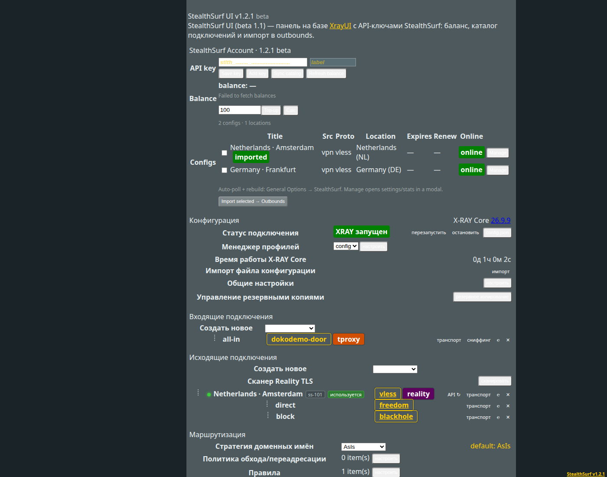
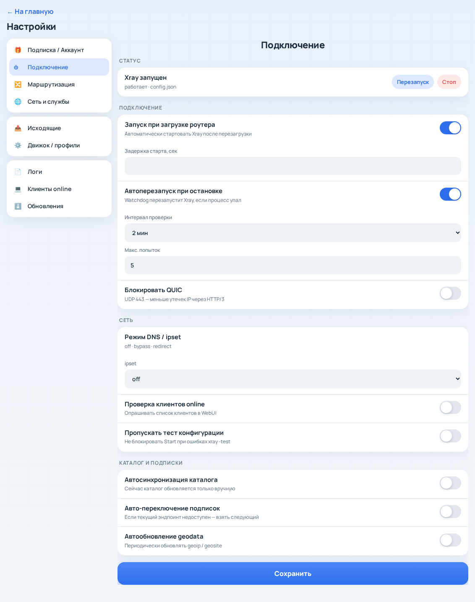
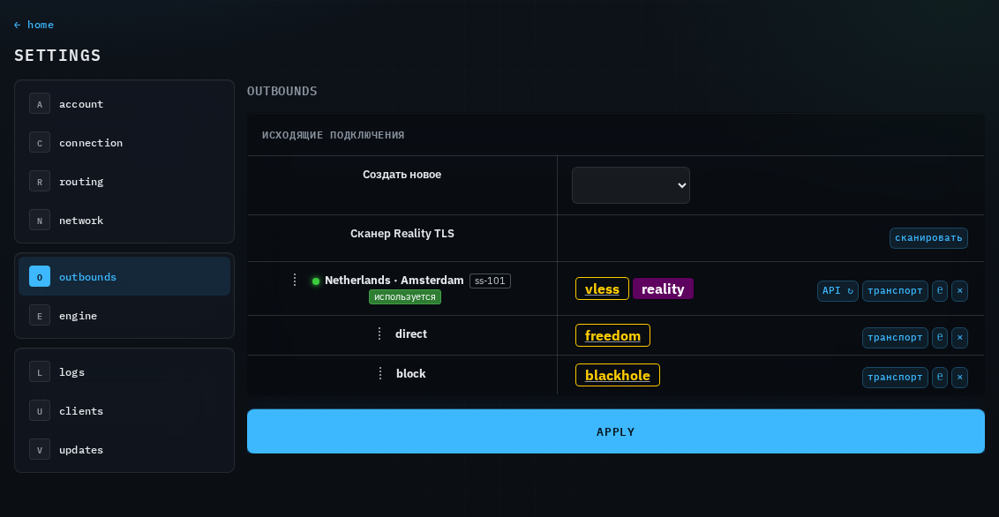
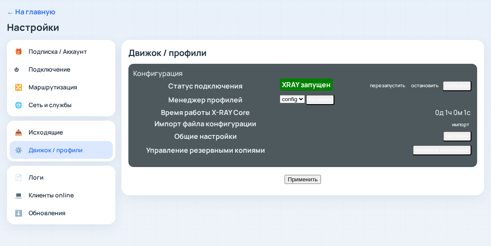
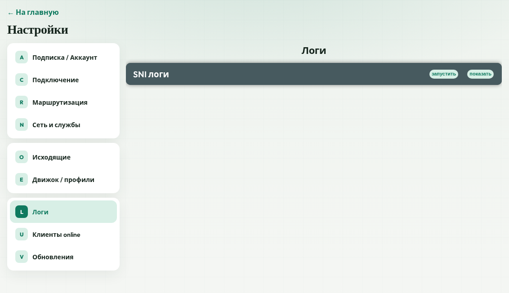
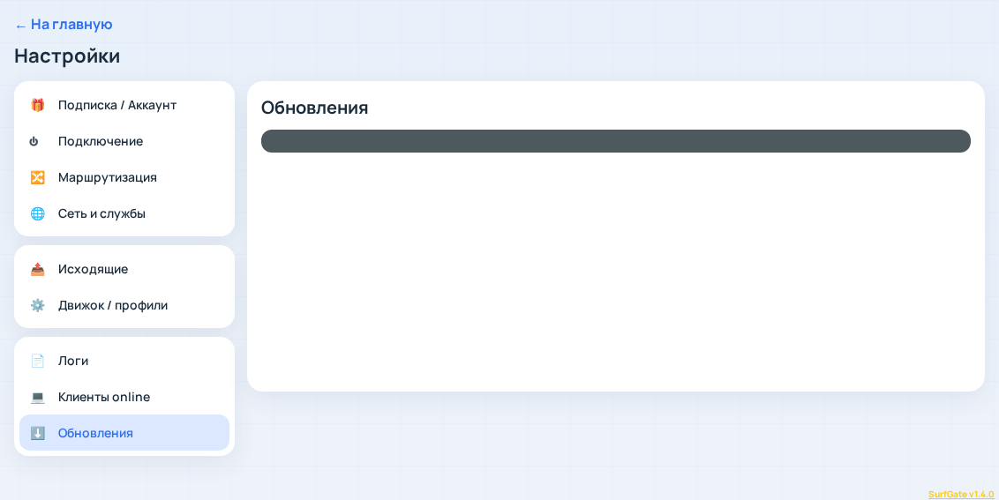

<p align="center">
  
</p>

<h1 align="center">SurfGate</h1>

<p align="center">
  <strong>Своя панель VPN на Asuswrt-Merlin</strong><br>
  <code>LAN:1131</code> · transparent proxy · StealthSurf API · CLI <code>surfgate</code><br>
  Не пересекается с официальным StealthSurf на <code>:8800</code>
</p>

<p align="center">
  <a href="https://github.com/Homavi88/Stealthsurf-Asus/releases/latest"></a>
  <a href="https://github.com/Homavi88/Stealthsurf-Asus/releases/latest"></a>
  
</p>

<p align="center">
  <a href="./docs/promo/index.html"><strong>📘 Промо / гайд (HTML)</strong></a>
  ·
  <a href="#установка"><strong>Установка</strong></a>
  ·
  <a href="#cli"><strong>CLI</strong></a>
  ·
  <a href="#возможности"><strong>Возможности</strong></a>
  ·
  <a href="#backup"><strong>Backup</strong></a>
  ·
  <a href="./CHANGELOG.md"><strong>Changelog</strong></a>
</p>

---

Один ключ `stlth_…` — и весь LAN/Wi‑Fi идёт через узлы **StealthSurf**.  
Актуальная версия **1.4.14**. Runtime-тег **`ssurf`** (`/jffs/addons/ssurf`, `/jffs/scripts/ssurf`) — официальный `/jffs/addons/stealthsurf` не трогается.

> **Полный обзор со скриншотами:** откройте [`docs/promo/index.html`](./docs/promo/index.html) в браузере (локально или через GitHub).

## Содержание

1. [Установка](#установка)
2. [Панель :1131](#панель-1131)
3. [Старт за 5 шагов](#старт-за-5-шагов)
4. [Возможности](#возможности)
5. [Веб-интерфейс (скриншоты)](#веб-интерфейс)
6. [Настройки Connection](#настройки-connection)
7. [CLI](#cli)
8. [Диагностика](#диагностика)
9. [Backup / restore](#backup)
10. [Рядом с official / XrayUI](#рядом-с-официальным-stealthsurf)
11. [Проверка на роутере](#проверка-на-роутере)
12. [Сборка](#сборка)
13. [Что нового](#что-нового)

## Установка

Нужны Merlin, JFFS custom scripts и Entware (`amtm`):

```sh
/opt/bin/curl -fsSL https://raw.githubusercontent.com/Homavi88/Stealthsurf-Asus/main/install.sh | sh
```

Панель:

```text
http://192.168.50.1:1131/
```

(подставьте свой LAN IP). Пакет: [Releases → latest](https://github.com/Homavi88/Stealthsurf-Asus/releases/latest) — `asuswrt-merlin-surfgate.tar.gz`.

Обновление с 1.x — тем же `install.sh`; ключи мигрируют `stealthsurf.conf` → `ssurf.conf`.  
CLI: **`surfgate`** (алиасы `ssurf` / `ss`; **не** `/opt/bin/stealthsurf`).

## Панель :1131

| | |
| --- | --- |
| URL | `http://<lan_ip>:1131/` |
| Файлы | `/jffs/addons/ssurf` |
| Скрипт | `/jffs/scripts/ssurf` |
| Conf / Xray | `/opt/etc/ssurf.conf` · `/opt/etc/xray/ssurf` |
| Служба | `surfgate panel start\|stop\|restart\|status` |
| Пароль | `surfgate panel set-password` (Basic Auth, опционально) |
| Порт / IP | `panel_port=1131`, опц. `panel_ip=…` в conf |

Опционально: logout → login в WebUI → **VPN → SurfGate** (Merlin-вкладка).

## Старт за 5 шагов

1. API-ключ → **Sync catalog**
2. Выбрать конфиг → **Import** (`ss-<id>` + default route)
3. **Start** — в Outbounds 🟢/🔴
4. По желанию: Connection (kill-switch, DNS-only, LAN MAC) / Routing
5. Устройства в Wi‑Fi уже через StealthSurf

## Возможности

| | |
| --- | --- |
| **Панель :1131** | Статус, throughput, ЦП/ОЗУ, настройки по разделам |
| **Каталог API** | Sync / автосинк, import, autofit, traffic/stats, renew/top-up |
| **Transparent proxy** | Весь LAN (`ipsec=off`) или smart proxy (`redirect` + geosite) |
| **VPN hardening** | NTP, WAN reconnect, kill-switch, LAN/guest/IPv6, DNS lock, preflight |
| **Диагностика** | Speed test, DNS/IPv6 leak, Observatory probes |
| **Логи** | App / Access / Error / Devices |
| **Updates** | GitHub check + опциональный auto-install |
| **CLI** | `surfgate` · `up dn re st sy ls ap pf sp dns bak panel` |
| **Изоляция** | `ssurf` paths · `SSURF_*` · table 78 — рядом с official `:8800` и XrayUI |

Протоколы: всё, что умеет установленный Xray-core (VLESS / Trojan / SS / Hysteria / WireGuard…).

## Веб-интерфейс

<p align="center">
  
</p>

| Аккаунт | Подключение |
| --- | --- |
|  |  |

<p align="center">
  
</p>

| Routing | Сеть / DNS |
| --- | --- |
|  |  |

| Outbounds | Engine / backup |
| --- | --- |
|  |  |

| Logs | Clients | Updates |
| --- | --- | --- |
|  |  |  |

Полный тур со подписями — в [промо-странице](./docs/promo/index.html).

## Настройки Connection

| Опция | Смысл |
| --- | --- |
| Запуск при загрузке | Автостарт Xray после ребута |
| Kill-switch | Блок LAN→WAN без марки, пока VPN desired |
| Кому VPN | `all` / selected MAC / exclude MAC |
| Гостевая Wi‑Fi | `follow` · `vpn` · `direct` |
| IPv6 | `proxy` · `block` · `ignore` |
| DNS только через Xray | DNS leak lock |
| Диагностика | Preflight · скорость · DNS leak |

## CLI

```sh
surfgate key 'stlth_…'
surfgate sy && surfgate ls
surfgate ap <id> && surfgate up
surfgate pf && surfgate sp && surfgate dns
surfgate bak
surfgate panel status
surfgate h    # справка · surfgate m — меню
```

| Команда | Действие |
| --- | --- |
| `up` / `dn` / `re` | старт / стоп / рестарт |
| `st` | статус |
| `sy` · `ls` | sync · список каталога |
| `ap` / `ic` `<id>` | import → `ss-<id>` |
| `refresh` · `autofit` | пересборка / подбор |
| `bal` · `stats` · `traffic` | баланс / статистика |
| `dv` | устройства VPN |
| `pf` · `sp` · `dns` | preflight · скорость · leak |
| `panel …` | start\|stop\|status\|url\|set-password |
| `bak` | backup-архив |
| `upd` · `fix` · `un --yes` | update · doctor · uninstall |

## Диагностика

| Тест | CLI | Что делает |
| --- | --- | --- |
| Preflight | `surfgate pf` | NTP, WAN, TPROXY, Xray, конфликт XrayUI |
| Speed | `surfgate sp` | Mbps ↓/↑ + latency |
| DNS leak | `surfgate dns` | wiring + resolvers vs WAN DNS, IPv6 |

WebRTC проверяйте с клиента: [browserleaks.com/webrtc](https://browserleaks.com/webrtc).

## Backup

```sh
surfgate bak
# → /opt/share/ssurf/backup/*.tar.gz
```

**В архиве:** профили `/opt/etc/xray/ssurf/*.json`, cert (если есть), `/opt/etc/ssurf.conf`, `/opt/share/ssurf/data`.  
**Restore:** UI → Engine → Backup (CLI restore пока нет). После restore — `restart` Xray.  
**Не входит:** API-кэши каталога, логи, файлы панели. Подробности и ограничения — в [промо → Backup](./docs/promo/index.html#backup).

## Рядом с официальным StealthSurf

| | SurfGate | Official |
| --- | --- | --- |
| Каталог | `/jffs/addons/ssurf` | `/jffs/addons/stealthsurf` |
| Панель | `:1131` | `:8800` |
| Conf / Xray | `ssurf.conf` · `/opt/etc/xray/ssurf` | — |
| Firewall | `SSURF_*` · table 78 | — |

### Рядом с stock XrayUI

Не включайте transparent proxy у обоих сразу. SurfGate покажет баннер конфликта и запретит Start.

| | SurfGate | XrayUI |
| --- | --- | --- |
| Profile | `/opt/etc/xray/ssurf/config.json` | `/opt/etc/xray/config.json` |
| PID | `/var/run/ssurf-xray.pid` | `/var/run/xray.pid` |
| FW / mark | `SSURF*` · `0x20000` · 78 | `XRAYUI*` · `0x10000` · 77 |
| Ports | `5699` / `10185` / `10186` | `5599` / `10085` / `10086` |

<p align="center">
  
</p>

Если официальная панель `:8800` пропала после старых установок:

```sh
surfgate un --yes 2>/dev/null || sh /jffs/scripts/ssurf uninstall
curl -fsSL https://cdn.stealthsurf.net/app/router/merlin.sh | sh
```

## Проверка на роутере

```sh
surfgate v && surfgate st && surfgate panel status
surfgate key 'stlth_…' && surfgate sy && surfgate ls
surfgate ap <id> && surfgate up
surfgate pf && surfgate sp && surfgate dns
surfgate bak
```

С LAN-клиента: exit IP (`ifconfig.me`), [dnsleaktest.com](https://dnsleaktest.com), WebRTC leak.

## Как устроено

```text
LAN / Wi‑Fi ──► iptables TPROXY ──► Xray (all-in :5699)
                                      │
               outbounds ss-<id>  ◄────┤  routing
                                      ▼
                              StealthSurf nodes
                                      ▲
                 Bearer stlth_… ──────┘
                 api.stealthsurf.net
```

## Сборка

```sh
pnpm install
pnpm run pack   # → packaged/asuswrt-merlin-surfgate.tar.gz
```

CI публикует GitHub Release на тег `v*`.

## Что нового

| | |
| --- | --- |
| **1.4.14** | Speed + DNS leak tests (panel/CLI) |
| **1.4.13** | VPN hardening, app/device logs, GitHub auto-update |
| **1.4.12** | Geek panel, install UX, geodata, VPN devices |
| **1.4.11** | Полная изоляция runtime `ssurf` |
| **1.4.0** | Бренд SurfGate, пакет `asuswrt-merlin-surfgate.tar.gz` |

Полный журнал: [CHANGELOG.md](./CHANGELOG.md).

## Документация и лицензия

- **Промо / гайд (HTML):** [docs/promo/index.html](./docs/promo/index.html)
- Провайдер: [docs.stealthsurf.net](https://docs.stealthsurf.net)
- Атрибуция: [ATTRIBUTION.md](./ATTRIBUTION.md) · [CC BY-NC-SA 4.0](./LICENSE)
