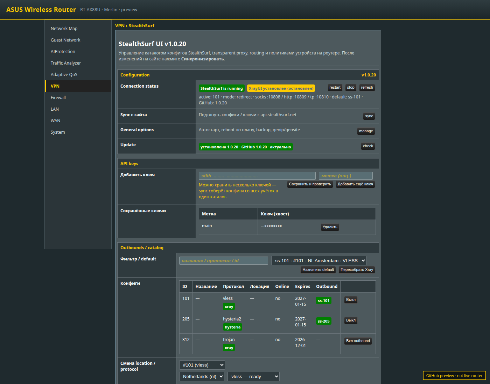
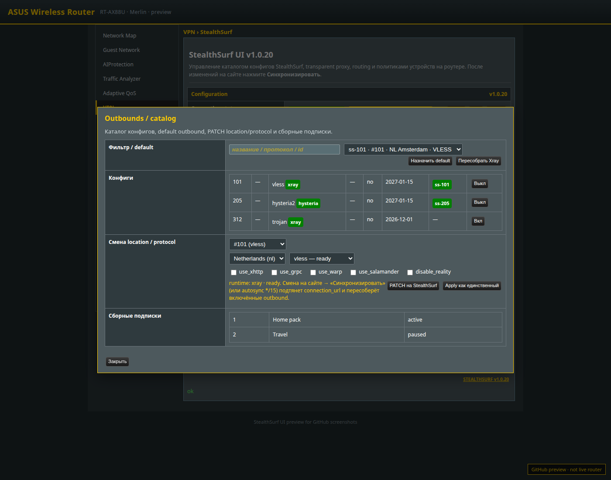
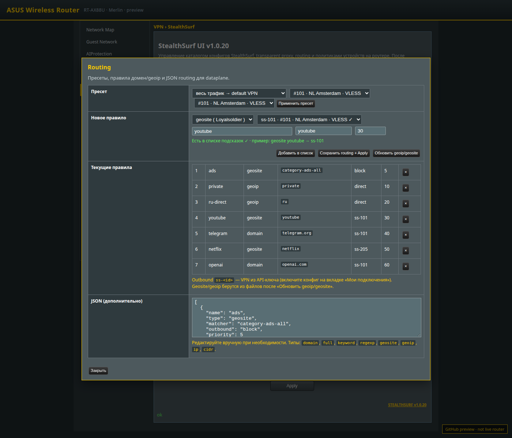
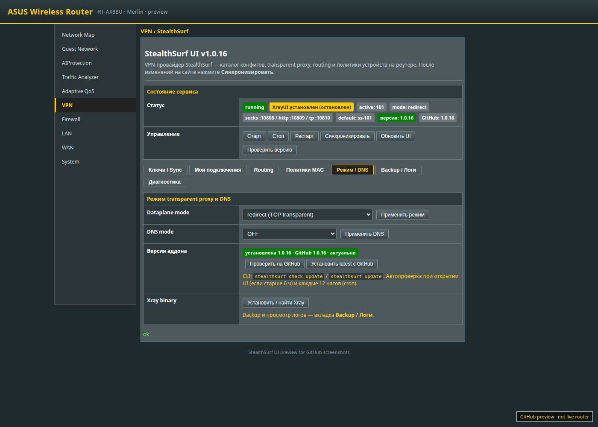
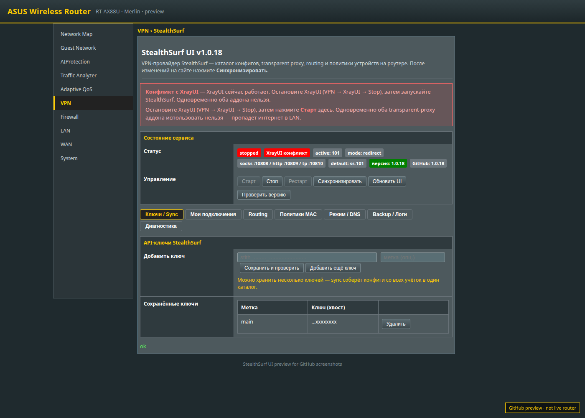

# StealthSurf UI for Asuswrt-Merlin

Аддон для роутеров на **Asuswrt-Merlin**: StealthSurf — провайдер VPN; transparent proxy, каталог конфигов и routing — на роутере через API-ключ(и) `stlth_…`.

**Актуальный релиз:** [v1.0.17](https://github.com/Homavi88/Stealthsurf-Asus/releases/latest)

## Установка на роутер

Нужны: Merlin + JFFS custom scripts + **Entware** (`amtm`).

```sh
curl -fsSL https://raw.githubusercontent.com/Homavi88/Stealthsurf-Asus/main/install.sh | sh
```

После установки: выйти из WebUI → зайти снова → **VPN → StealthSurf**  
(URL обычно `http://192.168.1.1/user1.asp`). Страница использует нативную оболочку Merlin
(меню, `FormTitle` / `FormTable`, `button_gen`) — как у XrayUI.

## Скриншоты WebUI

Превью страницы **VPN → StealthSurf** (нативная оболочка Merlin). Снято с локального UI-preview; на живом роутере выглядит так же.

| Статус / ключи | Каталог подключений |
| --- | --- |
|  |  |

| Routing | Режим / DNS |
| --- | --- |
|  |  |

Конфликт с XrayUI (старт заблокирован):



Переснять: `node tools/capture-ui-screenshots.mjs`

## Быстрые команды CLI

Короткий CLI: **`ssurf`** (полное имя `stealthsurf` тоже работает).  
Справка: `ssurf h` · Меню: `ssurf m`

### Старт за минуту

```sh
ssurf key 'stlth_…'          # API-ключ
ssurf sy && ssurf ls         # sync + список конфигов
ssurf ap <id>                # apply конфиг
ssurf mode redirect          # transparent (или tproxy)
ssurf up                     # старт
ssurf st                     # статус
```

### Шпаргалка

| Команда | Действие |
| --- | --- |
| `ssurf up` / `on` | Старт VPN |
| `ssurf dn` / `off` | Стоп |
| `ssurf re` / `rs` | Рестарт |
| `ssurf st` | Статус (JSON) |
| `ssurf sy` | Sync с сайта |
| `ssurf ls` | Список конфигов |
| `ssurf ap <id>` | Apply конфиг |
| `ssurf en <id>` / `dis <id>` | Enable / disable outbound |
| `ssurf def <tag>` | Default outbound (`ss-101`, `direct`, …) |
| `ssurf key <stlth_…>` | Сохранить API-ключ |
| `ssurf mode proxy\|redirect\|tproxy` | Режим dataplane |
| `ssurf dns OFF\|BYPASS\|REDIRECT` | DNS-режим |
| `ssurf rb` | Пересобрать dataplane |
| `ssurf d` | Диагностика |
| `ssurf p` | Матрица протоколов |
| `ssurf log [src] [n]` | Логи (`activity`, `errors`, …) |
| `ssurf bak` / `baks` | Backup / список бэкапов |
| `ssurf cl` / `dev` | Клиенты LAN / устройства |
| `ssurf conn` | Проверка связи |
| `ssurf cu` && `ssurf upd` | Проверить и обновить с GitHub |
| `ssurf uf` | Force-update |
| `ssurf xray` / `geo` | Установить Xray / geodata |
| `ssurf doctor` | Восстановить UI / CLI / хуки |
| `ssurf un --yes` | Полное удаление |
| `ssurf m` | Интерактивное меню |

Если пропал интернет после transparent-режима:

```sh
ssurf mode proxy && ssurf dn
# или
ssurf doctor
```

Не запускайте StealthSurf, пока работает **XrayUI** (оба transparent proxy ломают LAN).

Подробнее: [docs/INSTALL.md](./docs/INSTALL.md) · [docs/CLI.md](./docs/CLI.md) · [docs/FAQ.md](./docs/FAQ.md)

## Как это устроено

```text
LAN / Wi‑Fi ──► iptables REDIRECT|TPROXY ──► Xray (dokodemo-door)
                                              │
                   outbounds: ss-<id> × N  ◄───┤  routing rules
                                              │  (domain → ss-101, …)
                                              ▼
                                      StealthSurf nodes
                                              ▲
                         Bearer stlth_… ──────┘
                         api.stealthsurf.net
```

- Ключи только на роутере (`/opt/etc/stealthsurf.conf`)
- Sync тянет все конфиги; при смене настроек на сайте — rebuild включённых outbound
- Multi-runtime: Xray + Hysteria2 (auto-download) + WG; AmneziaWG — если установлен `awg-quick`

## Быстрый UX

1. API-ключ → **Синхронизировать**
2. Enable outbounds + **default**
3. Режим **redirect** (или **tproxy**)
4. Опционально: routing / политики MAC
5. **Старт** — LAN без системного прокси идёт через StealthSurf

## Документация

- [docs/INSTALL.md](./docs/INSTALL.md) — установка, пути, smoke
- [docs/CLI.md](./docs/CLI.md) — короткие команды `ssurf`
- [docs/PROTOCOLS.md](./docs/PROTOCOLS.md) — протоколы и sync сайт→роутер
- [docs/TPROXY_VS_REDIRECT.md](./docs/TPROXY_VS_REDIRECT.md)
- [docs/POLICIES.md](./docs/POLICIES.md) · [docs/ROUTING.md](./docs/ROUTING.md)
- [docs/BACKUP_AND_LOGS.md](./docs/BACKUP_AND_LOGS.md) — backup и логи в WebUI
- [docs/FAQ.md](./docs/FAQ.md) · [docs/VERIFICATION_CHECKLIST.md](./docs/VERIFICATION_CHECKLIST.md)
- [docs/ROUTER_MATRIX.md](./docs/ROUTER_MATRIX.md) — заполнить после теста на железе
- [ROADMAP.md](./ROADMAP.md)

## Сборка из исходников

```sh
npm run pack   # packaged/asuswrt-merlin-stealthsurf.tar.gz
```

CI публикует Release на тег `v*`.

## Провайдер

- [docs.stealthsurf.net](https://docs.stealthsurf.net)
- [API](https://docs.stealthsurf.net/api)
