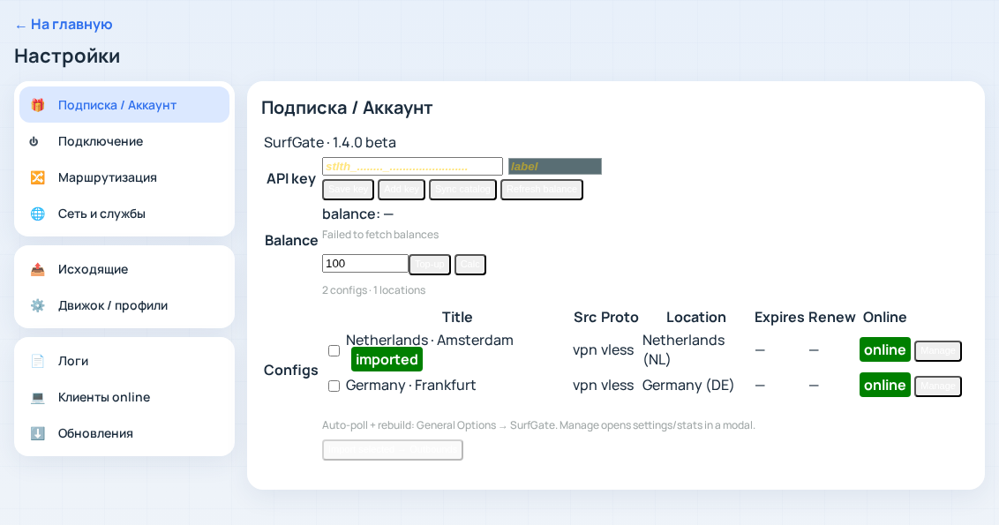
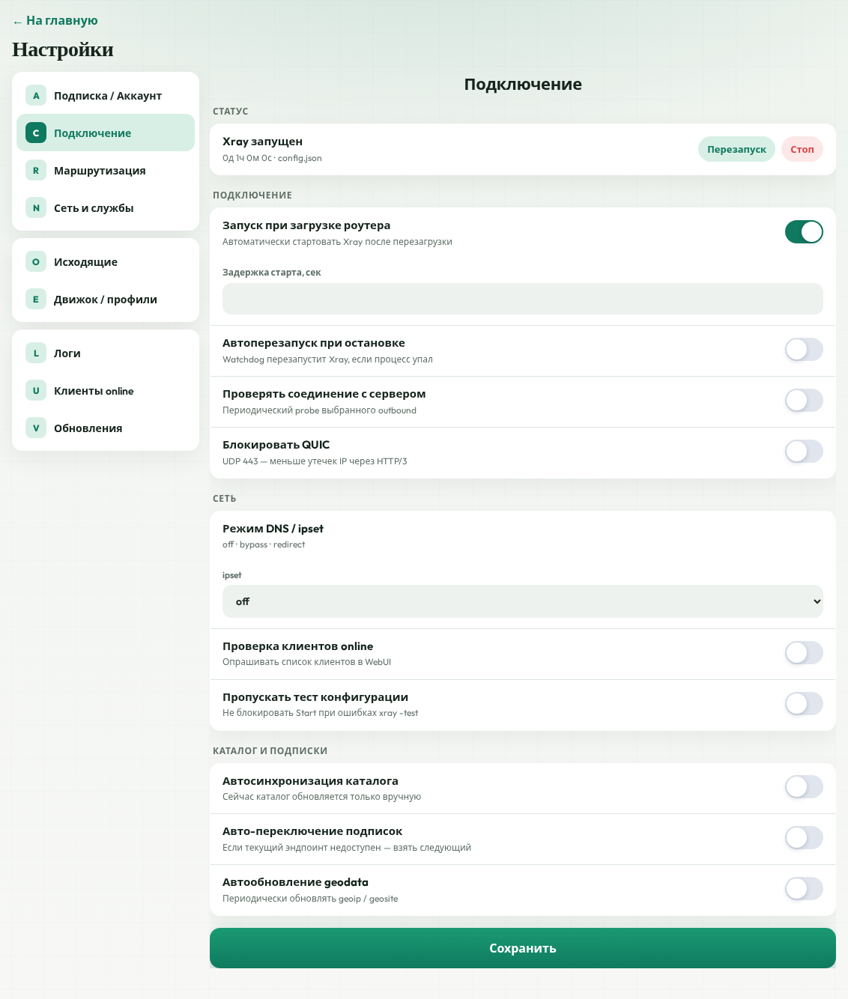
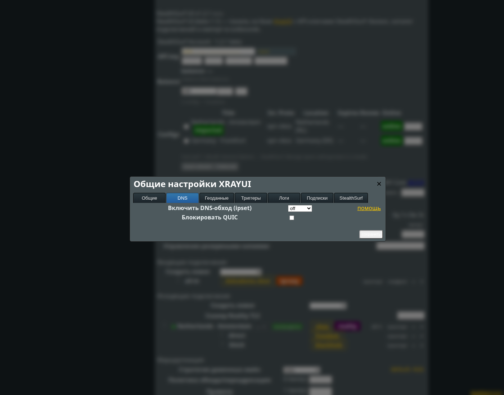
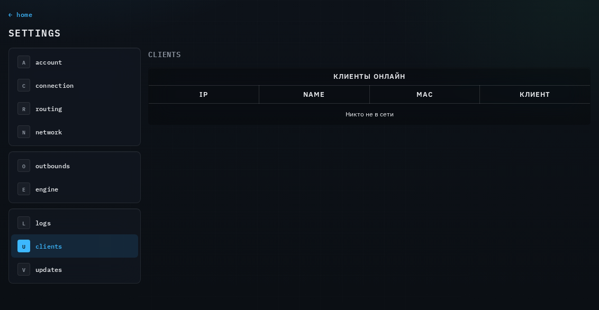

<p align="center">
  
</p>

<h1 align="center">SurfGate</h1>

<p align="center">
  <strong>Своя панель VPN на Asuswrt-Merlin</strong><br>
  <code>LAN:1131</code> · transparent proxy · StealthSurf API · CLI <code>surfgate</code><br>
  Не пересекается с официальным StealthSurf на <code>:8800</code>
</p>

<p align="center">
  <a href="https://github.com/Homavi88/Stealthsurf-Asus/releases/latest"></a>
  <a href="https://github.com/Homavi88/Stealthsurf-Asus/releases/latest"></a>
  
</p>

<p align="center">
  <a href="./docs/promo/index.html"><strong>📘 Промо / гайд (HTML)</strong></a>
  ·
  <a href="#установка"><strong>Установка</strong></a>
  ·
  <a href="#cli"><strong>CLI</strong></a>
  ·
  <a href="#возможности"><strong>Возможности</strong></a>
  ·
  <a href="#vpn-only-fail-closed"><strong>VPN-only</strong></a>
  ·
  <a href="#backup"><strong>Backup</strong></a>
  ·
  <a href="./CHANGELOG.md"><strong>Changelog</strong></a>
</p>

---

Один ключ `stlth_…` — и весь LAN/Wi‑Fi идёт через узлы **StealthSurf**.  
Актуальная версия **1.4.27**. Runtime-тег **`ssurf`** (`/jffs/addons/ssurf`, `/jffs/scripts/ssurf`) — официальный `/jffs/addons/stealthsurf` не трогается.

> **Полный обзор со скриншотами:** откройте [`docs/promo/index.html`](./docs/promo/index.html) в браузере (локально или через GitHub).

## Содержание

1. [Установка](#установка)
2. [Панель :1131](#панель-1131)
3. [Старт за 5 шагов](#старт-за-5-шагов)
4. [Возможности](#возможности)
5. [Веб-интерфейс (скриншоты)](#веб-интерфейс)
6. [Настройки Connection](#настройки-connection)
7. [VPN-only / fail-closed](#vpn-only-fail-closed)
8. [CLI](#cli)
9. [Диагностика](#диагностика)
10. [Backup / restore](#backup)
11. [Рядом с official / XrayUI](#рядом-с-официальным-stealthsurf)
12. [Проверка на роутере](#проверка-на-роутере)
13. [Сборка](#сборка)
14. [Что нового](#что-нового)

## Установка

Нужны Merlin, JFFS custom scripts и Entware (`amtm`):

```sh
/opt/bin/curl -fsSL https://raw.githubusercontent.com/Homavi88/Stealthsurf-Asus/main/install.sh | sh
```

Панель:

```text
http://192.168.50.1:1131/
```

(подставьте свой LAN IP). Пакет: [Releases → latest](https://github.com/Homavi88/Stealthsurf-Asus/releases/latest) — `asuswrt-merlin-surfgate.tar.gz`.

Обновление с 1.x — тем же `install.sh`; ключи мигрируют `stealthsurf.conf` → `ssurf.conf`.  
CLI: **`surfgate`** (алиасы `ssurf` / `ss`; **не** `/opt/bin/stealthsurf`).

## Панель :1131

| | |
| --- | --- |
| URL | `http://<lan_ip>:1131/` |
| Файлы | `/jffs/addons/ssurf` |
| Справка | в панели: **Настройки → справка** (тот же гайд, что [`docs/promo`](./docs/promo/index.html); также `http://<lan_ip>:1131/help/`) |
| Скрипт | `/jffs/scripts/ssurf` |
| Conf / Xray | `/opt/etc/ssurf.conf` · `/opt/etc/xray/ssurf` |
| Служба | `surfgate panel start\|stop\|restart\|status` |
| Пароль | `surfgate panel set-password` (Basic Auth, опционально) |
| Порт / IP | `panel_port=1131`, опц. `panel_ip=…` в conf |

Опционально: logout → login в WebUI → **VPN → SurfGate** (Merlin-вкладка).

## Старт за 5 шагов

1. API-ключ в **Настройки → аккаунт** → Sync catalog (или ↻ на главной)
2. На главной выбрать endpoint из списка API
3. **Start** — SurfGate сам импортирует `ss-<id>`, ставит default route и поднимает Xray
4. По желанию: Connection (kill-switch, **VPN-only**, DNS-only, LAN MAC) / Routing
5. Устройства в Wi‑Fi уже через VPN

Ручные подписки / outbound-редактор — по-прежнему в Merlin-вкладке и Outbounds; для API-ключей достаточно главной страницы.

## Возможности

| | |
| --- | --- |
| **Панель :1131** | Статус, throughput, ЦП/ОЗУ, настройки по разделам |
| **Каталог API** | Sync / автосинк, import, autofit, traffic/stats, renew/top-up |
| **Transparent proxy** | Весь LAN (`ipsec=off`) или smart proxy (`redirect` + geosite) |
| **VPN hardening** | NTP, WAN reconnect, kill-switch, **VPN-only fail-closed**, LAN/guest/IPv6, DNS lock, preflight |
| **Диагностика** | Speed test, DNS/IPv6 leak, Observatory probes |
| **Логи** | App / Access / Error / Devices |
| **Updates** | GitHub check + опциональный auto-install |
| **CLI** | `surfgate` · `up dn re st sy ls ap pf sp dns bak panel` |
| **Изоляция** | `ssurf` paths · `SSURF_*` · table 78 — рядом с official `:8800` и XrayUI |

Протоколы: всё, что умеет установленный Xray-core (VLESS / Trojan / SS / Hysteria / WireGuard…).

## Веб-интерфейс

<p align="center">
  
</p>

| Аккаунт | Подключение |
| --- | --- |
|  |  |

<p align="center">
  
</p>

| Routing | Сеть / DNS |
| --- | --- |
|  |  |

| Outbounds | Engine / backup |
| --- | --- |
|  |  |

| Logs | Clients | Updates |
| --- | --- | --- |
|  |  |  |

Полный тур со подписями — в [промо-странице](./docs/promo/index.html).

## Настройки Connection

| Опция | Смысл |
| --- | --- |
| Запуск при загрузке | Автостарт Xray после ребута |
| Kill-switch | Блок LAN→WAN без марки, пока VPN desired |
| VPN-only (fail-closed) | Домены только через VPN; при падении аддона/VPN — DROP clearnet + сброс conntrack |
| Split bypass | Домены в direct, минуя VPN |
| Кому VPN | `all` / selected MAC / exclude MAC |
| Гостевая Wi‑Fi | `follow` · `vpn` · `direct` |
| IPv6 | `proxy` · `block` · `ignore` |
| DNS только через Xray | DNS leak lock |
| Диагностика | Preflight · скорость · DNS leak |

## VPN-only / fail-closed

Нужно, чтобы конкретный сервис (банк, стриминг, работа) **всегда** шёл через VPN — и при падении аддона / VPN у провайдера / смене exit на ISP **сразу обрывал** соединение, а не утекал в clearnet.

**Панель:** Настройки → Connection → **VPN-only (fail-closed)** → список доменов → Apply / Restart.  
**Справка:** [промо → VPN hardening](./docs/promo/index.html#vpn) · [QA на роутере](./docs/qa-router.md#vpn-only--fail-closed).

| Слой | Что делает |
| --- | --- |
| Xray `surfgate-vpn-lock` | Домены → primary proxy outbound (правило первым в `routing.rules`) |
| ipset `SSURF_LOCK4` / `LOCK6` | Literal-домены заполняются через dnsmasq `ipset=/…` |
| iptables `SSURF_SVCLOCK` | Unmarked пакеты к LOCK IP → **DROP** (включая ESTABLISHED) |
| Stop (`surfgate dn`) | Flush conntrack по LOCK IP + DROP остаётся armed |
| Uninstall | Снимает lock / ipset / dnsmasq-строки |

```sh
# после Apply/Restart
jq '.routing.rules[0]' /opt/etc/xray/ssurf/*.json
# name: surfgate-vpn-lock · outboundTag: proxy

iptables -w -t filter -nvL SSURF_SVCLOCK
ipset list SSURF_LOCK4 | head

# fail-closed: Stop Xray — сервис не должен открыться через ISP
surfgate dn
# traffic to locked IPs → timeout / refuse
surfgate up
```

Рекомендуется `ipsec=redirect` (DNS наполняет LOCK/PROXY). Чистые `geosite:` теги принуждают к VPN, пока Xray жив; IP-level DROP сильнее для literal-хостов. Если домен в bypass и lock сразу — **побеждает lock**.

## CLI

```sh
surfgate key 'stlth_…'
surfgate sy && surfgate ls
surfgate ap <id> && surfgate up
surfgate pf && surfgate sp && surfgate dns
surfgate bak
surfgate panel status
surfgate h    # справка · surfgate m — меню
```

| Команда | Действие |
| --- | --- |
| `up` / `on` | старт |
| `dn` / `off` | стоп |
| `re` / `rs` | рестарт |
| `st` | статус (xray + панель + каталог + баланс) |
| `sy` | sync каталога API |
| `ls` / `l` | список конфигов |
| `ap` / `ic` / `imp` `<id>` | import → `ss-<id>` |
| `refresh` `<id>` | пересобрать `ss-*` из API |
| `bal` | баланс |
| `key` `'stlth_…'` | задать API-ключ |
| `addk` `<k>` `[lbl]` · `rmkey` `<k>` | добавить / удалить ключ |
| `autofit` `<id>` | подобрать сервер/протокол |
| `patch` `<id>` | PATCH settings (`SS_PATCH_BODY`) |
| `stats` `<id>` · `traffic` | статистика / трафик |
| `renew` `<id>` · `topup` `<amount>` | продление / пополнение |
| `dv` / `devices` | устройства VPN (IP / MAC / имя) |
| `pf` / `preflight` | NTP / WAN / TPROXY / Xray |
| `sp` / `speed` | тест скорости (Mbps ↓/↑ + latency; cron `speedtest_interval`) |
| `dns` / `dnstest` | DNS / IPv6 leak + WebRTC hint для LAN-браузера |
| `panel` `start\|stop\|status\|url\|set-password` | панель `:1131` |
| `bak` `[name]` | создать backup |
| `bak list` | список архивов |
| `bak restore` `<file.tar.gz>` | restore (с валидацией tar) |
| `bak clear` `[file]` | удалить все / один архив |
| `d` / `dg` | diagnostics |
| `upd` `[ver]` / `uf` | обновление аддона |
| `fix` / `doctor` | doctor |
| `v` / `ver` | версия |
| `un --yes` | uninstall |
| `h` / `?` · `m` | справка · интерактивное меню |

Примеры: `surfgate up` · `surfgate sy && surfgate ls` · `surfgate ap 101 && surfgate re` · `surfgate panel status` · `surfgate bak restore ssurf-….tar.gz`.

## Диагностика

| Тест | CLI | Что делает |
| --- | --- | --- |
| Preflight | `surfgate pf` | NTP, WAN, TPROXY, Xray, конфликт XrayUI |
| Speed | `surfgate sp` | Mbps ↓/↑ + latency (fallback URL) |
| DNS leak | `surfgate dns` | wiring + resolvers vs WAN DNS, IPv6 |

WebRTC проверяйте с клиента: [browserleaks.com/webrtc](https://browserleaks.com/webrtc).  
Полный чеклист на роутере: [`docs/qa-router.md`](./docs/qa-router.md).

## Backup

```sh
surfgate bak                 # → /opt/share/ssurf/backup/ssurf-<ts>.tar.gz
surfgate bak before-upgrade  # с меткой
surfgate bak list
surfgate bak restore ssurf-20261119-120000.tar.gz
surfgate bak clear           # все архивы
```

**В архиве:** профили `/opt/etc/xray/ssurf/*.json`, cert, `/opt/etc/ssurf.conf`, `/opt/share/ssurf/data`, custom scripts `/jffs/ssurf_custom` (+ legacy `/jffs/stealthsurf_custom` если есть).  
**Restore:** UI или CLI; перед распаковкой — allowlist путей (отклоняет чужие члены tar). После restore — `restart` Xray.  
**Не входит:** API-кэши каталога, логи, файлы панели. Обзор — в [промо → Backup](./docs/promo/index.html#backup).

## Рядом с официальным StealthSurf

| | SurfGate | Official |
| --- | --- | --- |
| Каталог | `/jffs/addons/ssurf` | `/jffs/addons/stealthsurf` |
| Панель | `:1131` | `:8800` |
| Conf / Xray | `ssurf.conf` · `/opt/etc/xray/ssurf` | — |
| Firewall | `SSURF_*` · table 78 | — |

### Рядом с stock XrayUI

Не включайте transparent proxy у обоих сразу. SurfGate покажет баннер конфликта и запретит Start.

| | SurfGate | XrayUI |
| --- | --- | --- |
| Profile | `/opt/etc/xray/ssurf/config.json` | `/opt/etc/xray/config.json` |
| PID | `/var/run/ssurf-xray.pid` | `/var/run/xray.pid` |
| FW / mark | `SSURF*` · `0x20000` · 78 | `XRAYUI*` · `0x10000` · 77 |
| Ports | `5699` / `10185` / `10186` | `5599` / `10085` / `10086` |

<p align="center">
  
</p>

Если официальная панель `:8800` пропала после старых установок:

```sh
surfgate un --yes 2>/dev/null || sh /jffs/scripts/ssurf uninstall
curl -fsSL https://cdn.stealthsurf.net/app/router/merlin.sh | sh
```

## Проверка на роутере

```sh
surfgate v && surfgate st && surfgate panel status
surfgate key 'stlth_…' && surfgate sy && surfgate ls
surfgate ap <id> && surfgate up
surfgate pf && surfgate sp && surfgate dns
# VPN-only (если настроен): jq '.routing.rules[0]' /opt/etc/xray/ssurf/*.json
# surfgate dn → iptables -nvL SSURF_SVCLOCK → locked сервис недоступен clearnet
surfgate bak
```

С LAN-клиента: exit IP (`ifconfig.me`), [dnsleaktest.com](https://dnsleaktest.com), WebRTC leak.  
Полный чеклист (guest / split / VPN-only / speed cron): [`docs/qa-router.md`](./docs/qa-router.md) и панель **Настройки → справка**.

## Как устроено

```text
LAN / Wi‑Fi ──► iptables TPROXY ──► Xray (all-in :5699)
                                      │
               outbounds ss-<id>  ◄────┤  routing
                                      ▼
                              StealthSurf nodes
                                      ▲
                 Bearer stlth_… ──────┘
                 api.stealthsurf.net
```

## Сборка

```sh
pnpm install
pnpm run pack   # → packaged/asuswrt-merlin-surfgate.tar.gz
```

CI публикует GitHub Release на тег `v*`.

## Что нового

| | |
| --- | --- |
| **1.4.27** | Reliable update detect via GitHub mirrors (browser + router) |
| **1.4.26** | Home update banner + Install; skip geosite/geoip re-download on update |
| **1.4.25** | Mobile panel: status card + horizontal settings nav |
| **1.4.24** | RU bypass toggles: .ru/.su/.рф + whitelist services → direct |
| **1.4.23** | Auto-repair corrupt config.json (NUL) before Start; atomic apply |

| **1.4.22** | Panel: keep settings page after actions; update install modal with stages |
| **1.4.21** | Home: vpn IP + lifetime traffic; LAN VPN/direct checklist |
| **1.4.20** | Update: github_download вместо BusyBox wget |
| **1.4.19** | Updates: кнопка «Установить» при доступной версии |
| **1.4.18** | API home: выбрать endpoint → Start (import + Xray); strip legacy reverse |
| **1.4.17** | VPN-only fail-closed для выбранных сервисов |
| **1.4.16** | Полный чеклист роутера в справке панели |
| **1.4.15** | Panel help, backup harden, VPN polish |
| **1.4.14** | Speed + DNS leak tests (panel/CLI) |
| **1.4.13** | VPN hardening, app/device logs, GitHub auto-update |
| **1.4.12** | Geek panel, install UX, geodata, VPN devices |
| **1.4.11** | Полная изоляция runtime `ssurf` |
| **1.4.0** | Бренд SurfGate, пакет `asuswrt-merlin-surfgate.tar.gz` |

Полный журнал: [CHANGELOG.md](./CHANGELOG.md).

## Документация и лицензия

- **Промо / гайд (HTML):** [docs/promo/index.html](./docs/promo/index.html) · в панели: **Настройки → справка**
- QA VPN на роутере: [`docs/qa-router.md`](./docs/qa-router.md) (guest, split bypass, **VPN-only fail-closed**, speed cron, DNS/IPv6/WebRTC)
- Провайдер: [docs.stealthsurf.net](https://docs.stealthsurf.net) · [API](https://docs.stealthsurf.net/api)
- Upstream XrayUI: [daniellavrushin.github.io/asuswrt-merlin-xrayui](https://daniellavrushin.github.io/asuswrt-merlin-xrayui/)
- Атрибуция: [ATTRIBUTION.md](./ATTRIBUTION.md) · лицензия [CC BY-NC-SA 4.0](./LICENSE) (© Daniel Lavrushin / contributors)
- Changelog: [CHANGELOG.md](./CHANGELOG.md)
