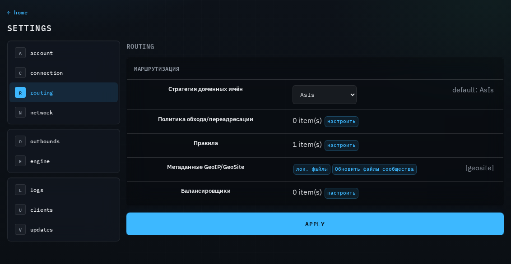
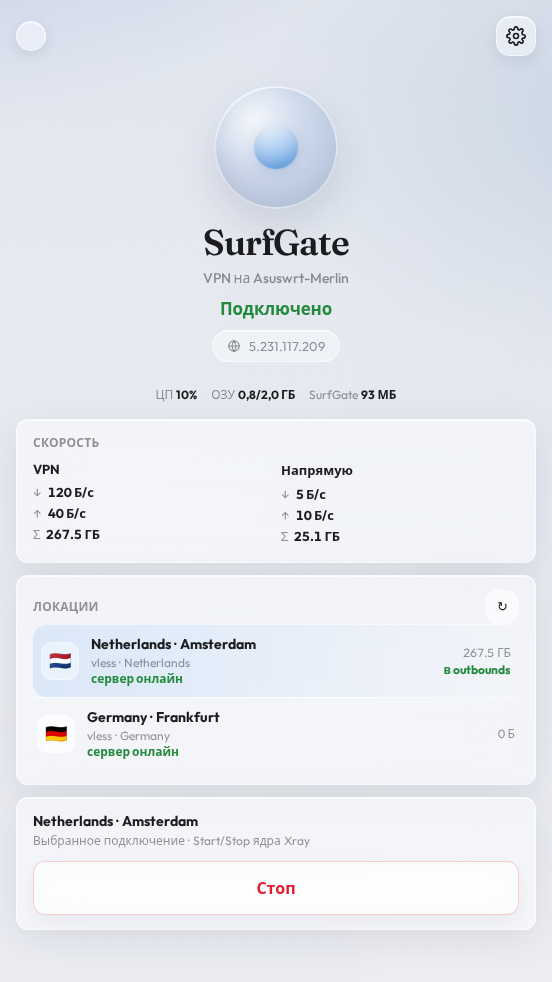
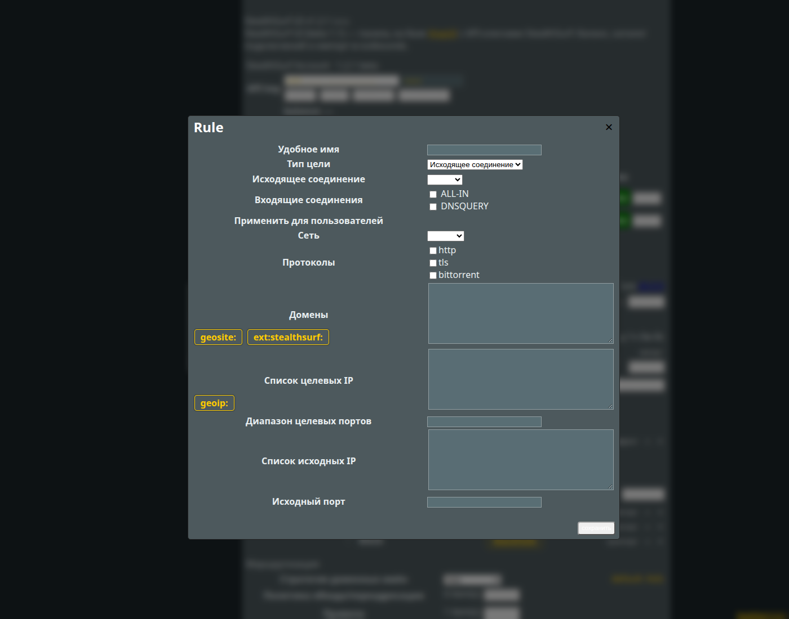
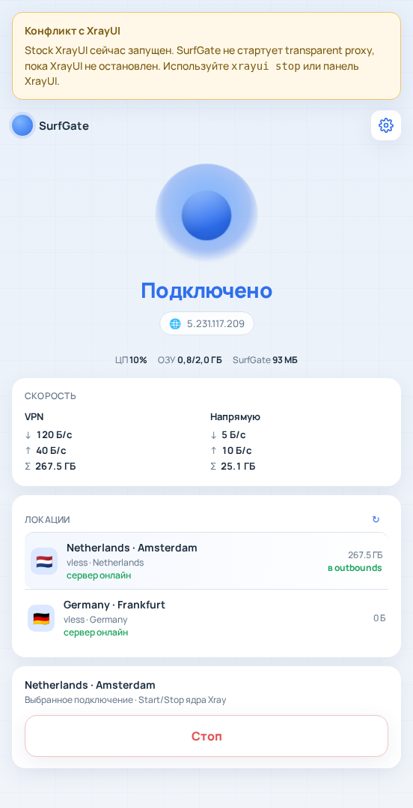

<p align="center">
  
</p>

<h1 align="center">StealthSurf</h1>

<p align="center">
  <strong>Своя панель на роутере Asuswrt-Merlin — по аналогии с официальным StealthSurf</strong><br>
  Отдельный адрес <code>LAN:1131</code> (официальный — <code>:8800</code>) · вкладка Merlin · API · transparent proxy · CLI <code>ssurf</code>
</p>

<p align="center">
  <a href="https://github.com/Homavi88/Stealthsurf-Asus/releases/latest"></a>
  <a href="https://github.com/Homavi88/Stealthsurf-Asus/releases/latest"></a>
  <a href="#установка"></a>
  <a href="https://docs.stealthsurf.net"></a>
  
</p>

<p align="center">
  <a href="#установка"><strong>Установка</strong></a> ·
  <a href="#панель-1131"><strong>Панель :1131</strong></a> ·
  <a href="#рядом-с-официальным-stealthsurf"><strong>Официальный :8800</strong></a> ·
  <a href="#что-нового-в-118"><strong>Changelog</strong></a> ·
  <a href="#cli-за-минуту"><strong>CLI</strong></a>
</p>

---

Один API-ключ `stlth_…` — и весь LAN/Wi‑Fi идёт через узлы StealthSurf. Основной UI — **своя панель** на порту **1131** (как у [официального приложения](https://stealthsurf.net/routers) на `:8800`, но отдельный аддон). Файлы лежат в `/jffs/addons/ssurf` и **не трогают** официальный `/jffs/addons/stealthsurf`.

Актуальная версия **1.2.1**.

## Установка

Нужны Merlin, JFFS custom scripts и Entware (`amtm`). Одна команда на роутере:

```sh
curl -fsSL https://raw.githubusercontent.com/Homavi88/Stealthsurf-Asus/main/install.sh | sh
```

Затем откройте панель:

```text
http://192.168.50.1:1131/
```

(подставьте свой LAN IP; рядом официальный StealthSurf может слушать `:8800`).  
Опционально: logout → login в WebUI → **VPN → StealthSurf**.  
Пакет: [**Releases → latest**](https://github.com/Homavi88/Stealthsurf-Asus/releases/latest).

Обновление с 1.0.x / 1.1.x / 1.2.0 — тем же именем пакета; ключи `stlth_…` мигрируют из `/opt/etc/stealthsurf.conf`.

### Панель :1131

| | |
| --- | --- |
| URL | `http://<lan_ip>:1131/` |
| Файлы | `/jffs/addons/ssurf` |
| Служба | `ssurf panel start\|stop\|restart\|status` |
| Пароль | `ssurf panel set-password` (Basic Auth, опционально) |
| Отдельный IP | в `/opt/etc/stealthsurf.conf`: `panel_ip=192.168.50.2` → alias на `br0` |
| Порт | `panel_port=1131` (по умолчанию) |

### Рядом с официальным StealthSurf

| | Наш аддон | Официальный VPN |
| --- | --- | --- |
| Каталог | `/jffs/addons/ssurf` | `/jffs/addons/stealthsurf` |
| Панель | `:1131` | `:8800` (`stealthsurf-routerd`) |
| Установка | этот `install.sh` | `curl …/merlin.sh \| sh` |

**1.2.0** ошибочно ставился в `/jffs/addons/stealthsurf` и мог затереть официальный пакет. С **1.2.1** путь свой. Если официальная панель `:8800` пропала:

```sh
# 1) убрать наш аддон
ssurf un --yes 2>/dev/null || sh /jffs/scripts/stealthsurf uninstall

# 2) поставить официальный заново
curl -fsSL https://cdn.stealthsurf.net/app/router/merlin.sh | sh
```

Если CLI «битый» — восстановление **нашего** аддона (не трогает official):

```sh
curl -fsSL https://raw.githubusercontent.com/Homavi88/Stealthsurf-Asus/main/install.sh | sh
```

## Что нового в 1.1.8+

| | |
| --- | --- |
| **1.2.1 Path fix** | Пакет в `/jffs/addons/ssurf` — больше не затирает официальный `/jffs/addons/stealthsurf` (`:8800`) |
| **1.2.0 Standalone panel** | Своя панель на `LAN:1131`; CGI API; опциональный secondary IP `panel_ip`; CLI `ssurf panel` |
| **1.1.16 Coexistence** | Удаление/стоп SS не трогает XrayUI (cron, TUN, dnsmasq, scribe, uninstall); порты `5699`/`10185`/`10186`; TUN table `251` |
| **1.1.15 Account UX** | Stats/Traffic в Vue-модалке (без Please wait); локация как страна (`Netherlands (NL)`); настройки/billing за кнопкой **Manage** |
| **1.1.14 API control** | Каталог: expires/локация/auto-renew + paid/cloud; PATCH settings; autofit под ISP; traffic/stats; renew/top-up; CLI `ssurf autofit|patch|stats|traffic|renew|topup` |
| **1.1.13 probe diagnosis** | У 🔴 outbound — короткая причина (timeout/reality/udp…), tooltip с подсказкой, кнопка **API ↻** пересобирает `ss-*` из каталога; CLI `ssurf refresh <id>` |
| **1.1.12 UI** | Убрана вкладка Simple — WebUI всегда показывает полный advanced-интерфейс |
| **1.1.11 popular rules** | Routing → Rules → «Популярные сервисы»: geosite/geoip пресет (YouTube, Instagram, Telegram, Kinopub, …) в одном domain + IP правиле |
| **1.1.10 titles** | В правилах / балансировщиках / SNI / sockopt / import — title из API вместо только `ss-<id>` |
| **1.1.9 geodata** | Мусор `outbound-ss-*.json` убирается из `data/` — больше нет `invalid attribute: ss-…` при recompile |
| **Автосинк каталога** | General Options → StealthSurf: опрос API по интервалу, сравнение настроек `ss-*`, автообновление при изменениях у провайдера |
| **Платформа XrayUI** | Полноценный WebUI: outbounds, routing, DNS, clients online, geodata, updates |
| **API-ключи** | Несколько `stlth_…`, баланс/реферал (RUB), sync каталога, импорт → `ss-<id>` |
| **Короткий CLI** | `ssurf` / `ss` · `up` `dn` `re` `st` `sy` `ls` `ap` `bal` `h` `m` |
| **Изоляция от XrayUI** | Свои config / PID / firewall mark / geodata; при работающем XrayUI — баннер и блокировка Start |
| **Статус outbounds** | После импорта включаются probes — в списке 🟢 / 🟡 / 🔴 |
| **Дефолтный профиль** | `all-in` + `direct` + `block`; импорт ставит выбранный узел default-маршрутом |

## Возможности

| | |
| --- | --- |
| **Каталог из API** | Sync / автосинк VPN + paid/cloud, expires/локация/auto-renew, PATCH settings, autofit под ISP, traffic/stats, renew/top-up |
| **Transparent proxy** | Весь LAN через Xray (`ipsec=off`) или smart proxy (`redirect` + geosite) |
| **Routing** | domain / geosite / geoip → `ss-<id>`, пресеты XrayUI |
| **Надёжность** | автостарт, watchdog, backup, geodata |
| **CLI** | короткий `ssurf` + меню `ssurf m` |

Протоколы ядра Xray: VLESS / Trojan / Shadowsocks / Hysteria / WireGuard и остальное, что умеет установленный Xray-core.

## Веб-интерфейс

Нативная оболочка Merlin: FormTable, кнопки справа, **Apply**, footer версии.

<p align="center">
  
</p>

| Каталог | Подсказки доменов |
| --- | --- |
|  |  |

| Mode / DNS | Настройки |
| --- | --- |
|  |  |

## Старт за 5 шагов

1. Вставить API-ключ → **Sync catalog**
2. Выбрать подключения → **Import** (становятся `ss-<id>` + default route)
3. **Start** — в Outbounds появятся 🟢/🔴 статусы
4. По желанию: routing / General Options
5. Устройства в Wi‑Fi идут через StealthSurf без системного VPN на телефонах

## CLI за минуту

```sh
ssurf key 'stlth_…'
ssurf sy && ssurf ls
ssurf ap <id>          # import + default route + status probes
ssurf up && ssurf st
ssurf h                # справка · ssurf m — меню
```

| | |
| --- | --- |
| `ssurf up` / `dn` / `re` / `st` | старт / стоп / рестарт / статус |
| `ssurf sy` · `ls` · `ap <id>` | sync · список · import |
| `ssurf refresh <id>` | пересобрать `ss-*` из API |
| `ssurf bal` · `key` · `addk` | баланс · ключ |
| `ssurf bak` · `upd` · `fix` | backup · update · doctor |
| `ssurf h` · `ssurf m` | справка · меню |

## Рядом с XrayUI

StealthSurf **1.1.16** держит своё состояние и **безопасен при удалении/остановке** рядом с stock XrayUI:

| | StealthSurf | Stock XrayUI |
| --- | --- | --- |
| Profile | `/opt/etc/xray/stealthsurf/config.json` | `/opt/etc/xray/config.json` |
| Conf | `/opt/etc/stealthsurf.conf` | `/opt/etc/xrayui.conf` |
| Settings | `stealthsurf_*` | `xray_*` |
| PID | `/var/run/stealthsurf-xray.pid` | `/var/run/xray.pid` |
| Firewall | `STEALTHSURF*` · mark `0x20000` · table `78` | `XRAYUI*` · `0x10000` · `77` |
| TUN | table `251` · prio `47/53` · iface `ss0` | table `250` · `49/51` · `xray0` |
| Ports | dokodemo `5699` · API `10185` · metrics `10186` | `5599` · `10085` · `10086` |
| Cron / Scribe | `stealthsurf*` · `syslog-ng.d/stealthsurf` | `xrayui*` · `syslog-ng.d/xrayui` |

Общее: `/opt/sbin/xray`, community `geoip.dat` / `geosite.dat` (uninstall SS их не удаляет, если XrayUI установлен).  
Стоп SS снимает только `#stealthsurf` из dnsmasq и свои firewall/TUN правила.  
**Не включайте transparent proxy у обоих аддонов одновременно** — StealthSurf покажет баннер «Конфликт с XrayUI» и запретит Start, пока XrayUI работает.

<p align="center">
  
</p>

## Как устроено

```text
LAN / Wi‑Fi ──► iptables TPROXY ──► Xray (all-in :5699)
                                      │
               outbounds ss-<id>  ◄────┤  routing (stealthsurf-default)
                                      ▼
                              StealthSurf nodes
                                      ▲
                 Bearer stlth_… ──────┘
                 api.stealthsurf.net
```

## Сборка

```sh
pnpm install
pnpm run pack   # → packaged/asuswrt-merlin-stealthsurf.tar.gz
```

CI публикует GitHub Release на тег `v*`.

## Документация и лицензия

- Провайдер: [docs.stealthsurf.net](https://docs.stealthsurf.net) · [API](https://docs.stealthsurf.net/api)
- Upstream XrayUI: [daniellavrushin.github.io/asuswrt-merlin-xrayui](https://daniellavrushin.github.io/asuswrt-merlin-xrayui/)
- Атрибуция: [ATTRIBUTION.md](./ATTRIBUTION.md) · лицензия [CC BY-NC-SA 4.0](./LICENSE) (© Daniel Lavrushin / contributors)
- Changelog: [CHANGELOG.md](./CHANGELOG.md)
