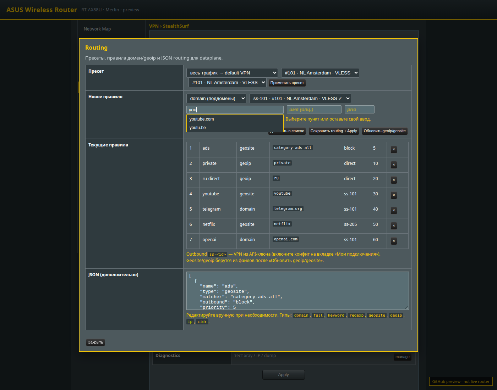
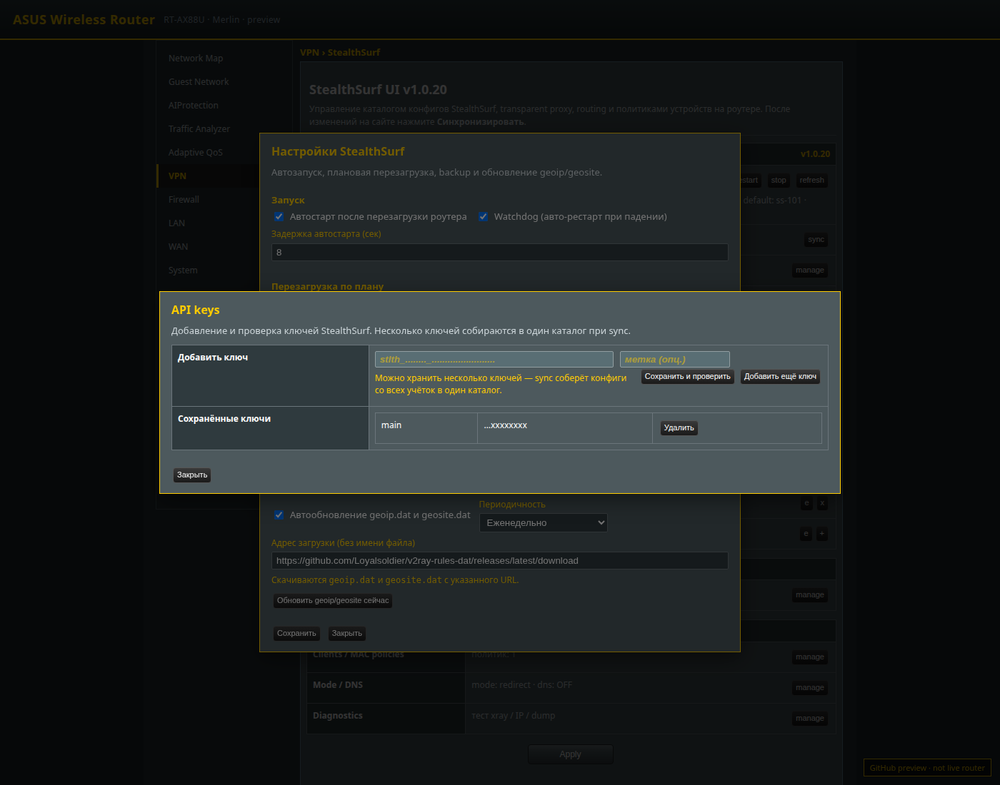

<p align="center">
  
</p>

<h1 align="center">StealthSurf</h1>

<p align="center">
  <strong>VPN провайдера — на весь дом через роутер Asuswrt-Merlin</strong><br>
  WebUI как у нативных аддонов Merlin · sync с API · transparent proxy · routing · CLI <code>ssurf</code>
</p>

<p align="center">
  <a href="https://github.com/Homavi88/Stealthsurf-Asus/releases/latest"></a>
  <a href="https://github.com/Homavi88/Stealthsurf-Asus/releases/latest"></a>
  <a href="#установка"></a>
  <a href="https://docs.stealthsurf.net"></a>
  
</p>

<p align="center">
  <a href="#установка"><strong>Установка</strong></a> ·
  <a href="#что-нового-в-11"><strong>1.1</strong></a> ·
  <a href="#возможности"><strong>Возможности</strong></a> ·
  <a href="#веб-интерфейс"><strong>WebUI</strong></a> ·
  <a href="#cli-за-минуту"><strong>CLI</strong></a> ·
  <a href="#рядом-с-xrayui"><strong>XrayUI</strong></a>
</p>

---

Один API-ключ `stlth_…` — и весь LAN/Wi‑Fi идёт через узлы StealthSurf: без клиента на телефонах, с балансом/каталогом из API, импортом в outbounds и коротким CLI `ssurf`. Вкладка **VPN → StealthSurf**.

Платформа **1.1.x beta** — ребренд и доработка [asuswrt-merlin-xrayui](https://github.com/DanielLavrushin/asuswrt-merlin-xrayui) (Vue 3 + shell): полноценные inbounds/outbounds, routing, DNS, geodata, firewall/TPROXY + StealthSurf API.

## Установка

Нужны Merlin, JFFS custom scripts и Entware (`amtm`). Одна команда на роутере:

```sh
curl -fsSL https://raw.githubusercontent.com/Homavi88/Stealthsurf-Asus/main/install.sh | sh
```

Затем: logout → login в WebUI → **VPN → StealthSurf**  
Актуальный пакет: [**Releases → latest**](https://github.com/Homavi88/Stealthsurf-Asus/releases/latest) (`asuswrt-merlin-stealthsurf.tar.gz`).

Обновление с 1.0.x / 1.1.x — тем же именем пакета; ключи `stlth_…` мигрируют из `/opt/etc/stealthsurf.conf`.

Если CLI «битый» и не запускается — восстановление:

```sh
cd /tmp && curl -fsSL -o ss.tgz \
  https://github.com/Homavi88/Stealthsurf-Asus/releases/latest/download/asuswrt-merlin-stealthsurf.tar.gz \
&& rm -rf /jffs/addons/stealthsurf && mkdir -p /jffs/addons \
&& tar -xzf ss.tgz -C /jffs/addons \
&& mv -f /jffs/addons/stealthsurf/stealthsurf /jffs/scripts/stealthsurf \
&& chmod 0755 /jffs/scripts/stealthsurf \
&& ln -sf /jffs/scripts/stealthsurf /opt/bin/stealthsurf \
&& ln -sf /jffs/scripts/stealthsurf /opt/bin/ssurf \
&& ln -sf /jffs/scripts/stealthsurf /opt/bin/ss \
&& sh /jffs/scripts/stealthsurf install
```

## Что нового в 1.1

| | |
| --- | --- |
| **Платформа XrayUI** | Полноценный WebUI: outbounds, routing, DNS, clients online, geodata, updates |
| **API-ключи** | Несколько `stlth_…`, баланс/реферал (RUB), sync каталога, импорт → `ss-<id>` |
| **Короткий CLI** | `ssurf` / `ss` · `up` `dn` `re` `st` `sy` `ls` `ap` `bal` `h` `m` |
| **Изоляция от XrayUI** | Свои config / PID / firewall mark / geodata; при работающем XrayUI — баннер и блокировка Start |
| **Статус outbounds** | После импорта включаются probes — в списке 🟢 / 🟡 / 🔴 |
| **Дефолтный профиль** | `all-in` + `direct` + `block`; импорт ставит выбранный узел default-маршрутом |

## Возможности

| | |
| --- | --- |
| **Каталог из API** | Sync конфигов StealthSurf, несколько ключей, импорт в Outbounds |
| **Transparent proxy** | Весь LAN через Xray (`ipsec=off`) или smart proxy (`redirect` + geosite) |
| **Routing** | domain / geosite / geoip → `ss-<id>`, пресеты XrayUI |
| **Надёжность** | автостарт, watchdog, backup, geodata |
| **CLI** | короткий `ssurf` + меню `ssurf m` |

Протоколы ядра Xray: VLESS / Trojan / Shadowsocks / Hysteria / WireGuard и остальное, что умеет установленный Xray-core.

## Веб-интерфейс

Нативная оболочка Merlin: FormTable, кнопки справа, **Apply**, footer версии.

<p align="center">
  
</p>

| Каталог | Подсказки доменов |
| --- | --- |
|  |  |

| Mode / DNS | Настройки |
| --- | --- |
|  |  |

## Старт за 5 шагов

1. Вставить API-ключ → **Sync catalog**
2. Выбрать подключения → **Import** (становятся `ss-<id>` + default route)
3. **Start** — в Outbounds появятся 🟢/🔴 статусы
4. По желанию: routing / General Options
5. Устройства в Wi‑Fi идут через StealthSurf без системного VPN на телефонах

## CLI за минуту

```sh
ssurf key 'stlth_…'
ssurf sy && ssurf ls
ssurf ap <id>          # import + default route + status probes
ssurf up && ssurf st
ssurf h                # справка · ssurf m — меню
```

| | |
| --- | --- |
| `ssurf up` / `dn` / `re` / `st` | старт / стоп / рестарт / статус |
| `ssurf sy` · `ls` · `ap <id>` | sync · список · import |
| `ssurf bal` · `key` · `addk` | баланс · ключ |
| `ssurf bak` · `upd` · `fix` | backup · update · doctor |
| `ssurf h` · `ssurf m` | справка · меню |

## Рядом с XrayUI

StealthSurf **1.1.1+** держит своё состояние:

| | StealthSurf | Stock XrayUI |
| --- | --- | --- |
| Profile | `/opt/etc/xray/stealthsurf/config.json` | `/opt/etc/xray/config.json` |
| Conf | `/opt/etc/stealthsurf.conf` | `/opt/etc/xrayui.conf` |
| Settings | `stealthsurf_*` | `xray_*` |
| PID | `/var/run/stealthsurf-xray.pid` | `/var/run/xray.pid` |
| Firewall | `STEALTHSURF*` · mark `0x20000` · table `78` | `XRAYUI*` · `0x10000` · `77` |

Общее: `/opt/sbin/xray`, community `geoip.dat` / `geosite.dat`.  
**Не включайте transparent proxy у обоих аддонов одновременно** — StealthSurf покажет баннер «Конфликт с XrayUI» и запретит Start, пока XrayUI работает.

<p align="center">
  
</p>

## Как устроено

```text
LAN / Wi‑Fi ──► iptables TPROXY ──► Xray (all-in :5599)
                                      │
               outbounds ss-<id>  ◄────┤  routing (stealthsurf-default)
                                      ▼
                              StealthSurf nodes
                                      ▲
                 Bearer stlth_… ──────┘
                 api.stealthsurf.net
```

## Сборка

```sh
pnpm install
pnpm run pack   # → packaged/asuswrt-merlin-stealthsurf.tar.gz
```

CI публикует GitHub Release на тег `v*`.

## Документация и лицензия

- Провайдер: [docs.stealthsurf.net](https://docs.stealthsurf.net) · [API](https://docs.stealthsurf.net/api)
- Upstream XrayUI: [daniellavrushin.github.io/asuswrt-merlin-xrayui](https://daniellavrushin.github.io/asuswrt-merlin-xrayui/)
- Атрибуция: [ATTRIBUTION.md](./ATTRIBUTION.md) · лицензия [CC BY-NC-SA 4.0](./LICENSE) (© Daniel Lavrushin / contributors)
- Changelog: [CHANGELOG.md](./CHANGELOG.md)
