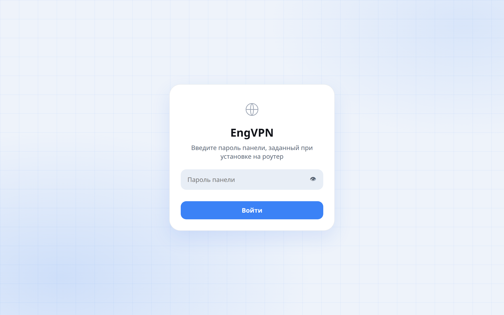
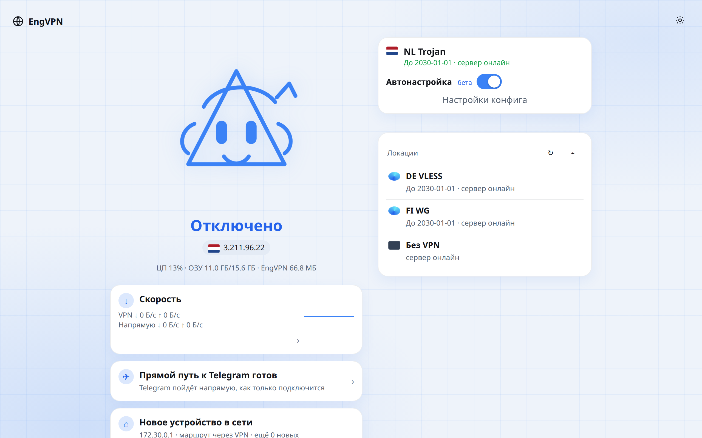
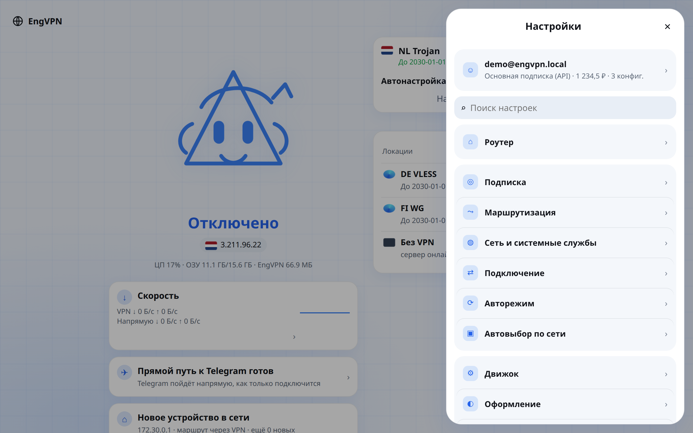
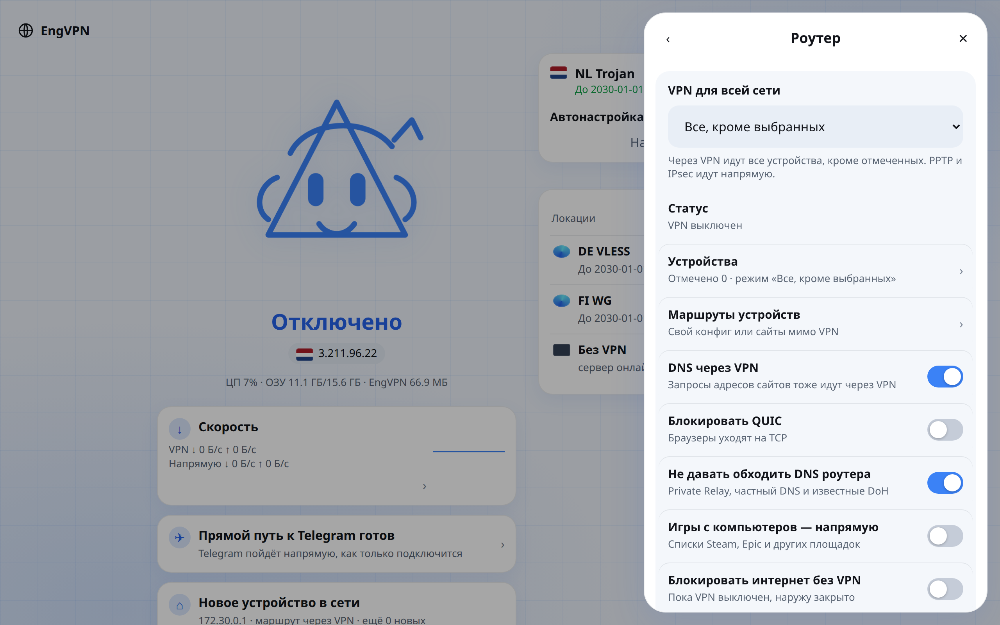
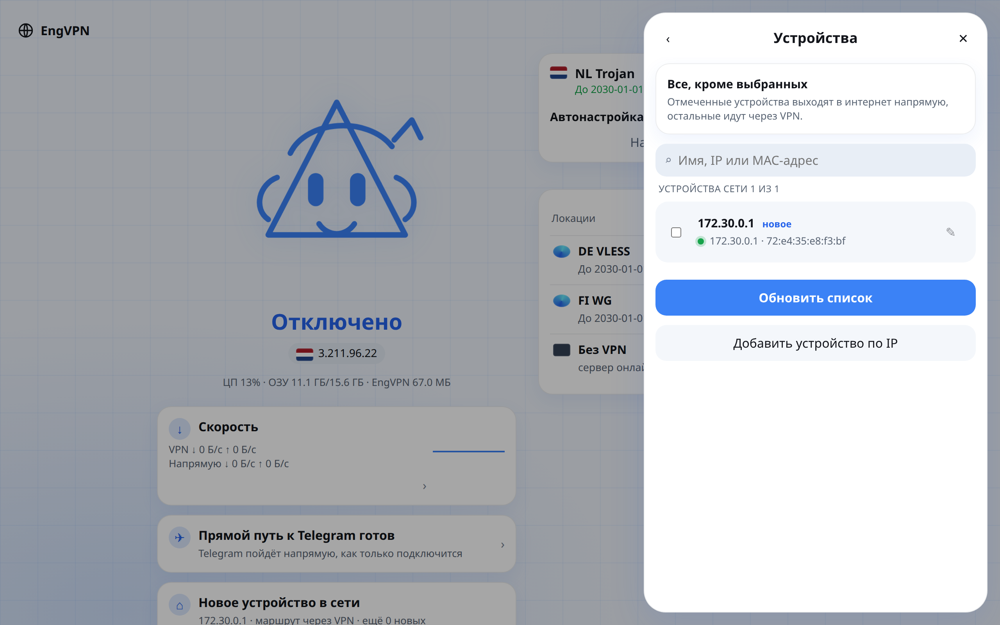

# EngVPN — аддон для Asuswrt-Merlin

Открытый VPN-аддон для Merlin с панелью, близкой к StealthSurf. Только открытые компоненты (панель на Node / Entware, Xray · sing-box · mihomo, open zapret/nfqws, Cloudflare WARP API). **Не** содержит проприетарных бинарников и торговых марок StealthSurf.

| | |
| --- | --- |
| Версия | **0.5.26** ([`VERSION`](./VERSION)) |
| Панель | `http://<lan_ip>:8790/` (пароль по умолчанию; можно пропустить при установке) |
| Префикс установки | `/jffs/addons/engvpn` или `/tmp/mnt/<USB>/engvpn` |
| CLI | `engvpnd` (`$PREFIX/sbin/engvpnd`; symlink `/opt/bin/engvpnd` + `profile.add`) |
| Изоляция | Не трогает SurfGate `:1131`, официальный StealthSurf `:8800` и alfa `:8788` |

Релиз: [engvpn-0.5.26](https://github.com/Homavi88/Stealthsurf-Asus/releases/tag/engvpn-0.5.26) (после публикации feed)

---

## Требования

1. **Asuswrt-Merlin** с включёнными пользовательскими скриптами JFFS  
2. **Entware** (`amtm`) и **Node.js**: `opkg update && opkg install node`  
3. Root-доступ по SSH и HTTPS-клиент (`curl`)  
4. Место и ОЗУ (пороги `merlin.sh`):
   - **≥256 МБ** ОЗУ (`MIN_MEMORY_KB`)
   - **≥20 МБ** свободно на выбранном носителе для новой установки (`MIN_FREE_KB`); при обновлении — **≥10 МБ** (`MIN_UPDATE_FREE_KB`)
   - **≥32 МБ** свободно в `/tmp` на время загрузки и распаковки (`MIN_TMP_FREE_KB`)
   - USB только **ext2/3/4** (NTFS / exFAT не подходят)

### Куда ставить

- **Предпочтительно JFFS** (`/jffs/addons/engvpn`): переживает извлечение флешки, хуки Merlin работают без гонок `post-mount`. Берите JFFS, если свободно **≥20 МБ** (лучше оставить запас **~30–40 МБ** под бэкапы и обновления).
- **USB**, если JFFS тесный: флешка **ext4**, путь `/tmp/mnt/<имя>/engvpn`. Пока флешка не смонтирована, сервис не поднимется до `post-mount`.
- Интерактивный установщик показывает **нужно** (≥20 МБ) и **свободно** для JFFS и каждой подходящей USB.

## Установка

```sh
curl -fsSL https://raw.githubusercontent.com/Homavi88/Stealthsurf-Asus/main/engvpn/merlin.sh | sh
```

В интерактивном режиме установщик сначала спросит **куда ставить** (нужно vs свободно):

```text
Куда установить EngVPN?
Нужно ≥20 МБ на выбранном носителе (новая установка).
[1] Роутер (JFFS) — нужно ~20 МБ, свободно ~XX МБ — /jffs/addons/engvpn
[2] Флешка sda1 — нужно ~20 МБ, свободно ~YY МБ — /tmp/mnt/sda1/engvpn
Выбор [1]:
```

По умолчанию — JFFS, если хватает места (≥20 МБ / `MIN_FREE_KB`); иначе первая подходящая USB (ext2/3/4). Рекомендации по выбору носителя — в [Куда ставить](#куда-ставить). `ENGVPN_PREFIX` пропускает этот вопрос. Затем — **задать пароль панели?** (по умолчанию да, рекомендуется; `n` = открытый доступ из LAN без входа), **резервная копия** (если EngVPN уже стоял), загрузка пакета, **SHA-256** / **Minisign**, запуск сервиса.

Ход установки печатается по этапам `[n/9]` (проверки → загрузка → проверка → распаковка → бэкап → файлы → хуки → пароль/открытый доступ → запуск). При сбое: `Ошибка на этапе «…»: …` и код выхода ≠ 0.

Без интерактива (автовыбор каталога как раньше — JFFS при достаточном месте, иначе USB):

```sh
# с паролем:
ENGVPN_PASSWORD='your-password' curl -fsSL https://raw.githubusercontent.com/Homavi88/Stealthsurf-Asus/main/engvpn/merlin.sh | sh
# или явно:
ENGVPN_PREFIX=/tmp/mnt/sda1/engvpn ENGVPN_PASSWORD='…' curl -fsSL …/merlin.sh | sh
# без пароля (панель открывается сразу в LAN):
ENGVPN_OPEN_PANEL=1 ENGVPN_PREFIX=/jffs/addons/engvpn curl -fsSL …/merlin.sh | sh
```

Если пароль пропущен: откройте `http://<lan_ip>:8790/` — вход не спрашивается. Позже: `engvpnd set-password` (снимет открытый доступ).

Переменные установщика (`merlin.sh`) и связанных скриптов — в разделе [CLI](#cli) ниже. Панель: `http://192.168.50.1:8790/` (подставьте LAN IP).

## Как удалить

После установки удобнее всего: **`engvpnd uninstall`** (синонимы `remove`, `удалить`) — вызывает тот же `install.sh uninstall`. Скрипт печатает этапы `[n/N]` (остановка → расписание → хуки → файлы), останавливает сервис панели, снимает хуки Merlin и `cru`, удаляет префикс EngVPN и `/tmp/engvpn`. **Не трогает** StealthSurf `:8800` (`/jffs/addons/stealthsurf`) и SurfGate.

JFFS (типичная установка):

```sh
# интерактивно: спросит, откатить из бэкапа или удалить полностью
engvpnd uninstall
# или полный путь к install.sh:
sh /jffs/addons/engvpn/share/engvpn/install.sh uninstall

# чистое удаление без отката и без нового бэкапа
ENGVPN_RESTORE=0 engvpnd uninstall
# то же + явный skip: ENGVPN_SKIP_BACKUP=1 ENGVPN_RESTORE=0 engvpnd remove
```

USB (если ставили на флешку): после 0.5.12 достаточно `engvpnd uninstall` (через `/opt/bin` или новый SSH-логин с `profile.add`). Полный путь:

```sh
ENGVPN_RESTORE=0 /tmp/mnt/<USB>/engvpn/sbin/engvpnd uninstall
# пример: ENGVPN_RESTORE=0 /tmp/mnt/sda1/engvpn/sbin/engvpnd uninstall
# workaround до обновления / без PATH: тот же полный путь
```

После **чистого** удаления новый снимок **не** пишется. Если остался соседний `.engvpn-backup`, `engvpnd remove` спросит, удалить ли его (**по умолчанию оставить**). `ENGVPN_DELETE_BACKUP=1` — удалить, `=0` — оставить без вопроса. Подробности — ниже и в [CLI → backup](#engvpnd-backup).

## Резервная копия и восстановление

Перед **install** и **upgrade** EngVPN пишет снимок в каталог `.engvpn-backup` рядом с префиксом (например `/jffs/addons/.engvpn-backup/`):

- дерево `data/` (state, account, transparent, DPI, WARP, SmartDNS, устройства);
- файлы пакета по манифесту (`sbin/engvpnd`, `share/engvpn/…`), чтобы можно было откатиться.

На **uninstall**:

1. Останавливается сервис; этапы печатаются как `[1/N] …`.  
2. Скрипт спрашивает: *«Восстановить EngVPN из резервной копии (откат)?»*  
   - **да** (`ENGVPN_RESTORE=1`) — распаковать последний бэкап в prefix, вернуть хуки, запустить сервис (uninstall отменяется → откат);  
   - **нет** (`ENGVPN_RESTORE=0` / ответ `n` / `ENGVPN_SKIP_BACKUP=1`) — удалить prefix **без** создания нового `.engvpn-backup` (старые снимки от install/upgrade не трогаются).
3. Если каталог `.engvpn-backup` ещё есть: *«Удалить каталог резервных копий …? [y/N]»* — **по умолчанию оставить**. `ENGVPN_DELETE_BACKUP=1` удаляет, `=0` оставляет.

Команды: `engvpnd backup …` — см. [CLI → backup](#engvpnd-backup).

## Аккаунт: API-ключ или URL подписки

В **Настройки → Аккаунт** (одно меню):

1. **Основной путь** — ключ StealthSurf HTTP API (`Authorization: Bearer stlth_…`). Документация: https://docs.stealthsurf.net/api  
2. **Если ключ пуст / неактивен** — на том же экране поля **URL подписки** или одиночный `vless://` / `trojan://` / `ss://`.

Ключ хранится только на роутере (`data/account.json`, mode 0600).

## Панель

UI по карте экранов StealthSurf, бренд **EngVPN**, русский интерфейс:

- **Главная** — статус, IP, нагрузка, скорость, локации; чип **«Доступна версия X.Y.Z»** (как у StealthSurf) с «Список изменений» и **Обновить**  
- **Роутер** — transparent (selected/exclude ↔ `devices.select`), **DNS hijack LAN :53 → :5353**, captive passthrough, DNS/QUIC/kill-switch, устройства из ARP/neigh/dnsmasq  
- **Сеть** — zapret → реальный **dpi.sh/nfqws** + **SmartDNS** (IP в iptables + домены в routing ядер)  
- **Подключение** — Cloudflare WARP + GRE (ошибка без `gre.conf`, без тихого ok)  
- **Движок** — Xray / **Ferrum (Xray Reality)** / sing-box / mihomo  
- **Обновления** — feed SHA-256 + Minisign (пустой `minisig` = не подписано, только SHA); живой журнал шагов обновления  
- **Проверки скрытности** — exit IP, DNS, IPv6, kill-switch, DPI/отпечаток, WebRTC-подсказка  
- **MQTT/HA** — публикация в `engvpn/vpn`; поддержка — ссылка на README/GitHub (не live-чат SS)  


### Что нового в 0.5.26

- **Storm-safe update:** `engvpnd update` и `merlin.sh` сначала делают kill-strays (и path-scoped pkill), чтобы шторм `service.sh`/`run.mjs` не мешал обновлению с 0.5.19.
- Панель: обновление запускается **detached** (журнал в `data/update-action.log`); экран **Обновления** показывает живой журнал шагов.
- Главная: баннер как у StealthSurf — синяя стрелка, «Доступна версия X.Y.Z», ссылка «Список изменений», кнопка **Обновить**.
- `engvpnd remove`: после удаления спрашивает про каталог `.engvpn-backup` (**по умолчанию оставить**); `ENGVPN_DELETE_BACKUP=1|0`.

### Что нового в 0.5.25

- **CPU leak / restart storm:** один supervisor на PREFIX — `flock` на `data/.supervisor.lock` держится всю жизнь фона (не отпускается при выходе `service.sh`); параллельные `start`/`restart` из хуков проигрывают lock и выходят. Один `run.mjs` — `.panel.lock` в `engvpnd serve` (exit 75). `kill-strays`/`stop` чистят все `service.sh`+`run.mjs` этого PREFIX. Лишние панели cull, без нового spawn.
- **Restart false-fail:** дети supervisor (`sleep`/`engvpnd`/`node`) больше не наследуют fd flock — иначе после `stop` orphan `sleep` держал lock и `restart`/`install` ложно «failed to start». `kill-strays` ждёт освобождения lock.
- Idle tick: без SSE панель почти спит (~10 с); `iptables -L` ≤ раз/10 с.
- Диагностика: топ процессов, подсветка engvpnd/node/ядер, hints на dual-panel и crash-loop sing-box (:20828).

### Что нового в 0.5.24

- Подключение Hysteria/sing-box: жёстче проверка порта **20828** — ждём освобождения после stop, убиваем orphan-ядра через `/proc` (BusyBox без `ss`), wait учитывает живой child (нет ложного OK на чужой listener при двух `run.mjs`).
- Таймаут listen 10 с (Merlin ARM); один повтор после освобождения порта, если ядро умерло до bind.

### Что нового в 0.5.22

- «Свои правила»: исправлен toast `null is not an object (… draft-action)` — селекты `sel()` пишут `data-input`, а «Добавить» искало `data-set`.
- Добавление правила читает `data-input`/`data-set` через `ctrl()`, с проверкой на null и пустое значение.
- Эфемерные селекты (`draft-*`, `cr-*`, `zkind`, `bridge-to`) больше не уходят в `patch`.

### Что нового в 0.5.21

- Роутер «VPN для всей сети»: один `<select>` на desktop и mobile (как «Метод transparent»), без стека кнопок. Режимы и persist без изменений.
- Настройки: CSS mobile-first — телефон list → detail; ≥900px nav + pane split (StealthSurf-style, без регрессии в «полный список без drill-down»).

### Что нового в 0.5.20

- Бэкап на BusyBox/Merlin USB: финализация списка файлов через redirect (`sort > files.sorted`), без хрупкого `sort -o` / `mv` отсутствующего файла.
- Если `files.sorted` пуст или пропал — оставляем несортированный список, не валим install/upgrade (`backup: cannot finalize file list`).

### Что нового в 0.5.19

- Настройки на ≥900px: оверлей на весь экран (nav + pane), не узкий sheet.
- Updates: одна версия из `share/engvpn/VERSION`; кнопка «Установить» скрыта, если уже на feed.
- Прогресс скачивания ядер/geo в панели (%, байты, фаза) через SSE.
- Установка по умолчанию качает Xray / Ferrum / sing-box / mihomo + geosite/geoip.
- Локации: ping справа зелёный/жёлтый/красный; флаги стран из имени.
- Скорость в **Мбит/с**.
- Роутер «VPN для всей сети»: настоящий выбор (выкл / все / только выбранные / все кроме) с persist + apply.

### Что нового в 0.5.18

- Feed `latest.json` всегда пишет HTTPS URL GitHub Releases (больше не `file:///agent/repos/…` из `build-package.sh`).
- `engvpnd update` / `merlin.sh`: чужие абсолютные/`file://` пути игнорируются, пакет берётся с `releases/download/engvpn-…`.
- Локальный smoke-feed — только `feed/latest.local.json` (в `.gitignore`).

### Что нового в 0.5.17

- Обновления: кнопка **«Установить обновление»**, когда feed новее текущей сборки (`engvpnd update` / `engvpnUpdateApply`).
- Тумблер **Автообновление** сохраняется в `data/updates.conf` и ставит Merlin `cru` (исправлен сброс после hydrate из устаревшего conf).
- Плановая проверка по-прежнему через интервал; ручная установка — сразу, без ночного окна.

### Что нового в 0.5.16

- Настройки: master-detail — слева меню разделов, справа содержимое (на телефоне по-прежнему список → экран).
- Главный экран без API-ключа и URL подписки: пустое состояние «добавьте ключ или URL», без фейковых NL/Trojan локаций; локальные и синхронизированные профили подписаны отдельно.
- Из `defaultState` / hydrate убраны alfa-заглушки (`alpha: true`), чтобы «сервер онлайн» не показывался без конфигурации.

### Что нового в 0.5.15

- `engvpnd remove` / `uninstall`: ответ `n`, `ENGVPN_RESTORE=0` и `ENGVPN_SKIP_BACKUP=1` **не** создают новый `.engvpn-backup`.
- Удаление печатает этапы `[1/4]…[4/4]` (остановка → расписание → хуки → файлы), без долгой тишины.
- Исправлена гонка BusyBox `sort`/`files.tmp` при создании бэкапа (`sort -o` до имени файла).

### Что нового в 0.5.14

- Тёмная тема по умолчанию (StealthSurf-like home): dual VPN / напрямую скорости + sparkline и экран «Скорость».
- iPhone Safari: paste/focus (не крадём фокус у `#q`), zoom (`maximum-scale=1`, inputs 16px), вертикальный текст в списках, аккуратный тёмный drawer настроек.
- Zapret YouTube/Discord: optimistic UI + `engvpnd dpi` в фоне (без Safari «Load failed» на долгий nfqws).
- Сломанные ядра (sing-box без `libresolv.so.2`, mihomo) — soft-hide в движке/диагностике.
- Пустой connect: CTA «Добавьте профиль» → Аккаунт; скорости с семплингом WAN/iptables ENGVPN.

### Что нового в 0.5.13

- Логин на iPhone Safari: поле «Пароль панели» снова открывает клавиатуру (без autofocus-ловушки, `inputmode` / `user-select` / `touch-action`, сохранение значения при «глазе»).
- Установка: вопрос «Задать пароль панели? [Y/n]» — по умолчанию да; `n` или `ENGVPN_OPEN_PANEL=1` / `ENGVPN_SKIP_PASSWORD=1` — открытый доступ из LAN без входа (`data/open-panel`). Позже: `engvpnd set-password`.

### Что нового в 0.5.12

- После установки `engvpnd` в PATH: symlink `/opt/bin/engvpnd` (Entware) и строка в `/jffs/configs/profile.add`; баннер печатает точные пути CLI.

### Что нового в 0.5.11

- После установки — явный баннер: «Откройте панель», полный URL `http://LAN:PORT` одной строкой (удобно копировать), отдельно адрес и порт; порт из `ENGVPN_PORT` (по умолчанию `8790`).

### Что нового в 0.5.10

- Разбор блока arch в ленте: гибкие пробелы вокруг `:` / `{`, **минифицированный** JSON в одну строку, кавычки у чисел; глубина `{…}` — поля соседнего arch не протекают.
- `curl`/`wget`: при HTTP-ошибке удаляется пустой файл; wget с `--tries=3`.
- `update.sh`: предупреждение при несовпадении `size` с лентой; отказ от ленты меньше 100 байт (как в `merlin.sh`).

### Что нового в 0.5.9

- Разбор ленты: `version` / поля пакета принимают **tab или space** (0.5.8 feed с `\t"version"` давал пустой version → ложное «нет пакета для merlin-aarch64»).
- При сбое разбора печатаются URL ленты, размер, первые строки, ключи arch и какие поля пустые.
- `size` в JSON без кавычек читается корректно; feed генерируется только с пробелами.

### Что нового в 0.5.8

- Загрузка пакета: **`curl -fL`** (следуют редиректам GitHub). Без `-L` получался файл **0 байт** и SHA `e3b0c442…` (пустой файл).
- Пустой/ошибочный HTTP-ответ отклоняется **до** проверки SHA; печатается размер; повтор через зеркала GitHub.
- То же в `update.sh` (самообновление с роутера).

### Что нового в 0.5.7

- В выборе каталога установки: **нужно ~20 МБ** и **свободно ~N МБ** рядом (порог `MIN_FREE_KB`).
- Сборки пакетов воспроизводимы (`tar` fixed mtime + `gzip -n`) — SHA feed совпадает с релизом после повторной сборки.
- При несовпадении SHA установщик печатает ожидаемую и фактическую сумму.

### Что нового в 0.5.6

- Короткие lifecycle-команды в `engvpnd`: `up`, `check`, `uninstall`/`remove`, `reinstall`, `restart`, `st`, `clean`, `priv`, `fix`, `ver` (см. [быстрые команды](#быстрые-команды)).
- `uninstall` / `remove` вызывают реальный `install.sh uninstall` (`ENGVPN_RESTORE`).
- `reinstall` — stop → принудительное обновление из feed в тот же prefix (данные сохраняются); `reinstall --wipe` стирает `data/` (нужно подтверждение / `ENGVPN_REINSTALL_WIPE=1`).

### Что нового в 0.5.5

- Интерактивный `merlin.sh`: выбор **JFFS или USB** со свободным местом; `ENGVPN_PREFIX` / `ENGVPN_PASSWORD` без лишних вопросов.
- В README — пороги места/ОЗУ и совет: **сначала JFFS** (≥20 МБ, лучше запас 30–40 МБ), USB ext4 только если JFFS тесный.

### Что исправлено в 0.5.4 (реальность, не «зелёный UI»)

- Ошибки SmartDNS / transparent / DPI / расписания обновлений **больше не маскируются** `ok: true` — UI показывает сбой и откатывает тумблер.  
- Чекбоксы устройств пишут `data/devices.select` → iptables selected/exclude.  
- DNS/adblock/dnsLock включают **REDIRECT :53** на EngVPN DNS (счётчики рекламы на реальном пути).  
- Domain SmartDNS читается ядрами из `bypass.routing.json`.  
- Captive «портал открыт» = passthrough iptables + политика direct.  

### Чего нет (намеренно / проприетарно StealthSurf)

- Закрытый Ferrum / WARP MASQUE / Amnezia SS / маскот / VKUI pixel / Gaming·Stream Deck — **MISSING**, не клонируем.

### Проверки скрытности

В панели: **Настройки → Проверки скрытности** (и ссылка из Диагностики). CLI:

```sh
engvpnd privacy              # полный отчёт JSON
engvpnd privacy dry-run
engvpnd privacy exit         # только exit IP
```

Что реально измеряется с роутера: curl WAN vs через SOCKS/HTTP edge; resolv/NVRAM DNS; `ip -6` + curl -6; цепочка `ENGVPN_KS`; статус nfqws и method transparent (TPROXY/REDIRECT). WebRTC с роутера недоступен — в UI есть ссылка на проверку с клиента LAN. Это **сигналы**, не гарантия анонимности.

### Скриншоты

Сняты с локальной EngVPN-панели (smoke, порт `8790`), бренд EngVPN — не StealthSurf.

| Логин | Главная |
| --- | --- |
|  |  |

| Настройки | Роутер |
| --- | --- |
|  |  |

| Устройства |
| --- |
|  |

Конфиги на диске (кратко):

| Файл | Назначение |
| --- | --- |
| `data/transparent.conf` | `mode=off\|all\|selected\|exclude`, `method=auto\|tproxy\|redirect`, `port`, `killswitch` |
| `data/devices.select` | IP или MAC (по одному на строку) для selected/exclude |
| `data/dpi.conf` | `enabled`, `queue`, `youtube`, `discord`, `mode=nfqws\|fake` |
| `data/warp.conf` / `warp.profile.ini` | режим WARP и профиль WireGuard |
| `data/gre.conf` | опциональный GRE (`gre_enabled`, remote/local) |
| `data/smartdns.conf` + `smartdns-bypass.txt` | обход VPN по домену/IP/CIDR |
| `data/updates.conf` | интервал проверки, `auto=0\|1`, ночное окно автоустановки |

Публичный ключ Minisign: [`keys/engvpn.minisign.pub`](./keys/engvpn.minisign.pub).

---

## CLI

Основная точка входа после установки — **`engvpnd`**. Бинарь всегда в **`$PREFIX/sbin/engvpnd`** (не `bin/`): например `/jffs/addons/engvpn/sbin/engvpnd` или `/tmp/mnt/<USB>/engvpn/sbin/engvpnd`.  
Установщик добавляет symlink **`/opt/bin/engvpnd`** (Entware) и строку в **`/jffs/configs/profile.add`**, чтобы короткие команды работали в SSH без полного пути. Баннер установки печатает точные пути.  
Большинство подкоманд вызывают скрипты из `$PREFIX/share/engvpn/`. Глобальный флаг:

```sh
engvpnd --data-dir /path/to/data <команда>
engvpnd --help
```

### Сводка `engvpnd`

| Команда | Назначение |
| --- | --- |
| `serve` | Панель в foreground (`node …/run.mjs`) |
| `set-password` | Пароль панели со stdin → pbkdf2 в `data/` |
| `status` / `st` | Панель + transparent |
| `stop` | Остановить процесс панели |
| `restart` | Перезапуск панели через `service.sh` |
| `version` / `ver` | Версия пакета |
| `update-check` / `check` | Сверка с feed |
| `update` / `up` | Самообновление из feed |
| `uninstall` / `remove` / `удалить` | Удаление (`install.sh uninstall`, `ENGVPN_RESTORE`) |
| `reinstall` / `переустановить` | Stop → force-update из feed (данные сохраняются); `--wipe` стирает `data/` |
| `schedule-update …` | Периодическая проверка (+ опц. автоустановка) через Merlin `cru` |
| `transparent …` | Прозрачный / выборочный VPN |
| `dpi …` | zapret/nfqws (NFQUEUE) |
| `privacy` / `priv` … | Проверки скрытности (exit/DNS/IPv6/kill-switch/DPI) |
| `warp …` | Cloudflare WARP + GRE |
| `backup …` | Снимок / откат |
| `smartdns …` | Обход доменов/IP |
| `discover` | Устройства LAN (JSONL) |
| `reconnect` / `fix` | Transparent (+dpi/smartdns) + restart сервиса |
| `cleanup` / `clean` | Снять transparent/dpi/smartdns/GRE и `/tmp/engvpn*` |
| `watchdog` | Проверка панели и восстановление правил |

### Быстрые команды

| Команда | Эквивалент | Что делает |
| --- | --- | --- |
| `engvpnd up` | `update` | Обновление из feed |
| `engvpnd check` | `update-check` | Есть ли новая версия |
| `engvpnd remove` | `uninstall` | Удаление (или откат по `ENGVPN_RESTORE`) |
| `engvpnd reinstall` | — | Переустановка пакета, **data/ сохраняется** |
| `engvpnd reinstall --wipe` | — | Стереть data/ + пакет из feed (`ENGVPN_REINSTALL_WIPE=1`) |
| `engvpnd st` | `status` | Статус панели |
| `engvpnd restart` | `service.sh restart` | Перезапуск панели |
| `engvpnd clean` | `cleanup` | Снять правила / tmp |
| `engvpnd priv` | `privacy` | Проверки скрытности |
| `engvpnd fix` | `reconnect` | Переприменить правила + restart |
| `engvpnd ver` | `version` | Версия |

Примеры повседневного использования:

```sh
engvpnd st
engvpnd ver
engvpnd check
engvpnd up
engvpnd transparent status
engvpnd discover
engvpnd priv
engvpnd backup create
engvpnd reinstall                 # пакет заново, пароль/данные на месте
ENGVPN_RESTORE=0 engvpnd remove   # полное удаление
engvpnd fix
engvpnd clean
engvpnd restart
```

### Панель и пароль

```sh
engvpnd serve [--data-dir DIR]          # обычно через service.sh, не вручную
echo 'secret-pass' | engvpnd set-password
engvpnd status
engvpnd stop
```

### Обновление и переустановка

```sh
engvpnd check                           # = update-check: installed=… feed=… update_available=0|1
engvpnd up                              # = update: скачать feed, SHA-256 (+ minisig), upgrade
engvpnd update 90                       # ждать старт сервиса до 90 с (по умолчанию 60)
engvpnd reinstall                       # stop + ENGVPN_FORCE_UPDATE=1 (data/ сохраняется)
ENGVPN_REINSTALL_WIPE=1 engvpnd reinstall --wipe   # стереть data/, затем пакет из feed
```

Переменные: `ENGVPN_FEED`, `ENGVPN_PACKAGE_PREFIX`, `ENGVPN_FORCE_UPDATE=1`, `ENGVPN_REINSTALL_WIPE=1`.

### Плановая проверка и автообновление

Панель → **Обновления**: интервал проверки (`6h` / `12h` / `1d` / `3d` / `7d` / `off`), тумблер **Автообновление** (по умолчанию **выкл.**) и кнопка **«Установить обновление»**, когда feed новее текущей версии.

- Проверка ходит в GitHub feed (`latest.json`), как `engvpnd update-check` / `Проверить сейчас`.
- **Установить обновление** сразу вызывает `engvpnd update` (SHA-256 + Minisign), без ожидания ночного окна.
- Если автообновление включено и в feed новее — в ночном окне (`window_start`–`window_end`, по умолчанию 02:00–05:00) тоже вызывается `engvpnd update`.
- Расписание хранится в `data/updates.conf` и ставится в Merlin **`cru`** (или `crontab`). После перезагрузки `services-start` / `post-mount` снова вызывает `schedule-update.sh install-cru` — job не теряется.

```sh
engvpnd schedule-update status          # conf + cru
engvpnd schedule-update install-cru     # переустановить job из updates.conf
engvpnd schedule-update run             # одна проверка (+ apply при auto=1)
engvpnd schedule-update write-conf interval=12h auto=0
```

Конфиг: `data/updates.conf` (`interval`, `auto=0|1`, `window_start`, `window_end`, …). Лог: `/tmp/engvpn-update-check.log`.

### Transparent

```sh
engvpnd transparent status
engvpnd transparent dry-run
engvpnd transparent apply               # то же, что start
engvpnd transparent start
engvpnd transparent stop
engvpnd transparent write-state         # только state-файл для replay
```

Конфиг: `data/transparent.conf` (`mode`, `method=auto|tproxy|redirect|prefer-tproxy`, `port`, `mark`, `table`, `killswitch`, `lan_if`, `lan_cidr`) + `data/devices.select`.

### DPI (zapret / nfqws)

```sh
engvpnd dpi status
engvpnd dpi dry-run
engvpnd dpi install                     # скачать nfqws при отсутствии
engvpnd dpi apply                       # то же, что start
engvpnd dpi start
engvpnd dpi stop
```

Конфиг: `data/dpi.conf`. Зеркало бинарника: `ENGVPN_ZAPRET_URL`.

### WARP / GRE

```sh
engvpnd warp status
engvpnd warp dry-run
engvpnd warp create                     # регистрация Cloudflare → warp.profile.ini
engvpnd warp import-file /path/to.ini
engvpnd warp gre-up
engvpnd warp gre-down
```

### Backup

```sh
engvpnd backup create
engvpnd backup list
engvpnd backup latest                   # путь к последнему архиву
engvpnd backup path                     # каталог бэкапов
engvpnd backup restore                  # восстановить latest в prefix
```

Переменные: `ENGVPN_SKIP_BACKUP=1`, `ENGVPN_BACKUP_DIR`.

### SmartDNS

```sh
engvpnd smartdns status
engvpnd smartdns dry-run
engvpnd smartdns write                 # только артефакты routing без iptables
engvpnd smartdns apply
engvpnd smartdns stop
```

При `enabled=1`: IP/CIDR → `RETURN` в цепочке `ENGVPN`; домены → `data/run/bypass.routing.json`, который **ядра** (Xray / sing-box / mihomo) мержат в routing как `direct`.

### Discover

```sh
engvpnd discover                        # JSONL: ip, mac, name, online
engvpnd discover /tmp/devices.jsonl     # опциональный путь вывода
```

Источники: ARP, `ip neigh`, dnsmasq leases, nvram clientlist.

### Сервис панели

```sh
sh /jffs/addons/engvpn/share/engvpn/service.sh start
sh /jffs/addons/engvpn/share/engvpn/service.sh stop
sh /jffs/addons/engvpn/share/engvpn/service.sh restart
sh /jffs/addons/engvpn/share/engvpn/service.sh check    # status — синоним
```

Порт панели: `ENGVPN_PORT` (по умолчанию `8790`). Лог: `/tmp/engvpn/engvpnd.log`.

### Установка / удаление (`install.sh`)

Вызывается из `merlin.sh` и `update.sh`; вручную:

```sh
sh …/share/engvpn/install.sh install <archive.tar.gz> <prefix>
sh …/share/engvpn/install.sh upgrade <archive> <version> <wait> <prefix>
sh …/share/engvpn/install.sh uninstall [<prefix>]
```

Удаление (предпочтительно через `engvpnd`):

```sh
engvpnd uninstall                       # = remove / удалить → install.sh uninstall
ENGVPN_RESTORE=0 engvpnd remove         # без отката
ENGVPN_RESTORE=1 engvpnd uninstall       # откат из бэкапа
# прямой вызов по-прежнему работает:
sh /jffs/addons/engvpn/share/engvpn/install.sh uninstall
```

### Установщик с роутера (`merlin.sh`)

```sh
curl -fsSL …/engvpn/merlin.sh | sh
ENGVPN_PASSWORD='…' curl -fsSL …/engvpn/merlin.sh | sh
ENGVPN_LOCAL_PACKAGE=/tmp/engvpn.tar.gz ENGVPN_PASSWORD='…' sh merlin.sh
```

### Netfilter / хуки Merlin

Внутренние хелперы (обычно не нужны вручную — их зовут `hook.sh` и `watchdog`):

```sh
sh …/share/engvpn/netfilter.sh ensure-port
sh …/share/engvpn/netfilter.sh replay
sh …/share/engvpn/netfilter.sh set-hold 120
```

`hook.sh` цепляется к `services-start`, `services-stop`, `post-mount`, `unmount`, `firewall-start`, `nat-start` (автостарт сервиса и replay правил после пересборки iptables).

### Переменные окружения

| Переменная | Где | Назначение |
| --- | --- | --- |
| `ENGVPN_PASSWORD` | merlin.sh | Пароль панели без TTY; также отключает вопрос «куда ставить» |
| `ENGVPN_OPEN_PANEL` / `ENGVPN_SKIP_PASSWORD` | merlin.sh | `1` — без пароля (открытый LAN-доступ; флаг `data/open-panel`) |
| `ENGVPN_PREFIX` | merlin.sh | Каталог установки (пропускает вопрос JFFS/USB) |
| `ENGVPN_LOCAL_PACKAGE` | merlin.sh | Локальный `.tar.gz` |
| `ENGVPN_LOCAL_VERSION` | merlin.sh | Метка версии для локального пакета |
| `ENGVPN_FEED` | merlin / update | URL `latest.json` |
| `ENGVPN_PACKAGE_PREFIX` | merlin / update | Префикс URL релизов |
| `ENGVPN_MINISIGN_PUB` | merlin.sh | URL/путь публичного ключа |
| `ENGVPN_SKIP_BACKUP` | install / backup / uninstall | `1` — не писать бэкап (в т.ч. при удалении) |
| `ENGVPN_RESTORE` | uninstall | `1` откат / `0` чистое удаление без нового бэкапа |
| `ENGVPN_BACKUP_DIR` | backup | Каталог снимков |
| `ENGVPN_PORT` | engvpnd / service | Порт панели (8790) |
| `ENGVPN_DATA_DIR` | engvpnd / скрипты | Каталог `data/` |
| `ENGVPN_NODE` | engvpnd | Явный путь к Node |
| `ENGVPN_FORCE_UPDATE` | update / reinstall | Обновить даже при той же версии |
| `ENGVPN_REINSTALL_WIPE` | reinstall --wipe | `1` подтвердить стирание `data/` |
| `ENGVPN_ZAPRET_URL` | dpi | URL архива zapret/nfqws |

---

## Сборка / smoke

```sh
cd engvpn
./build-package.sh
./smoke-test.sh
./publish-release.sh --push
```

## Отличия от официального StealthSurf

| Upstream | EngVPN 0.5 |
| --- | --- |
| Закрытый routerd / nfqws / Ferrum | Open Node + zapret/nfqws + Xray в слоте Ferrum |
| Облако / баланс только в приложении | Публичный API с вашим ключом + URL подписки |
| SmartDNS консоли SS | Локальный список доменов/IP → routing/iptables |
| WARP закрытый стек | Cloudflare client API → WireGuard |
| Только SHA в части сборок | SHA-256 + Minisign |
| Статический демон без Entware | **Entware Node** (осознанно) |
